# BUKU PANDUAN PENGGUNA
## SIPAYROLL — Sistem Penggajian Sekolah & Yayasan

---

| Informasi Dokumen | Keterangan |
| :--- | :--- |
| **Judul Aplikasi** | SIPAYROLL (Sistem Penggajian Sekolah & Yayasan) |
| **Nama Paket Proyek** | `payroll-sekolah-app` |
| **Versi Aplikasi** | `v1.0.0` |
| **Target Pengguna** | Pengguna Akhir (*Admin / Bendahara*, *Kepala Sekolah*, dan *Pendidik / Guru*) |
| **Tanggal Pembaruan** | 15 November 2026 |

---

> **Tentang Panduan Ini:**
> Buku panduan ini merupakan dokumentasi operasional resmi bagi seluruh pengguna akhir **SIPAYROLL** di lingkungan sekolah maupun yayasan. Untuk menjaga keseragaman dan kemudahan pembacaan, seluruh nama menu, tombol, tab, label kolom, status, dan pesan notifikasi ditulis **tebal** atau *miring* persis seperti yang tampil di layar aplikasi. Istilah **klik** digunakan secara seragam di seluruh bab untuk tindakan menekan tombol atau memilih tab (pada layar sentuh ponsel, Anda cukup mengetuk tombol atau tab tersebut).

---

## Ringkasan Peran Pengguna & Integrasi Data

| Peran Pengguna | Cara Terdaftar | Fokus Utama di Aplikasi |
| :--- | :--- | :--- |
| **Admin / Bendahara** | Terdaftar di tab `Users_Auth` pada Google Sheets sekolah | Mengelola data guru & komponen gaji (termasuk impor masal `.XLSX` ke Google Sheets), mencatat kehadiran & JTM, membuat draf penggajian, mengajukan persetujuan ke Kepala Sekolah, mengonfirmasi pembayaran gaji, serta mengatur identitas sekolah/yayasan. |
| **Kepala Sekolah** | Terdaftar di tab `Users_Auth` pada Google Sheets sekolah | Memantau pengajuan penggajian per periode, memeriksa rincian gaji setiap pendidik, serta memberikan persetujuan (**Setujui**) atau mengembalikan draf untuk perbaikan (**Revisi**). |
| **Pendidik / Guru** | Otomatis terhubung di `Users_Auth` saat Admin mengisi **Alamat Gmail Guru** di aplikasi atau mengimpor `.XLSX` | Memeriksa profil kepegawaian dan gaji bersih terakhir (*hanya baca*), melihat rincian Slip Gaji Digital yang telah disetujui/dibayarkan, serta mengunduh Slip Gaji Resmi berformat PDF. |

---

## Daftar Isi

- [Bab 1: Pendahuluan & Akses Akun](#bab-1-pendahuluan--akses-akun)
  - [1.1. Mengenal Aplikasi SIPAYROLL](#11-mengenal-aplikasi-sipayroll)
  - [1.2. Mengenal Mode Server Aktif dan Mode Simulasi](#12-mengenal-mode-server-aktif-dan-mode-simulasi)
  - [1.3. Kebijakan Akun, Registrasi, dan Lupa Kata Sandi](#13-kebijakan-akun-registrasi-dan-lupa-kata-sandi)
  - [1.4. Cara Masuk ke Portal (Login via Gmail OTP)](#14-cara-masuk-ke-portal-login-via-gmail-otp)
  - [1.5. Cara Keluar dari Aplikasi (Keluar)](#15-cara-keluar-dari-aplikasi-keluar)
- [Bab 2: Mengenal Antarmuka Aplikasi](#bab-2-mengenal-antarmuka-aplikasi)
  - [2.1. Mengenal Bilah Atas (Navbar)](#21-mengenal-bilah-atas-navbar)
  - [2.2. Mengatur Koneksi Server Google Sheets & Mode Simulasi](#22-mengatur-koneksi-server-google-sheets--mode-simulasi)
  - [2.3. Memasang SIPAYROLL ke Layar Utama Perangkat (PWA)](#23-memasang-sipayroll-ke-layar-utama-perangkat-pwa)
  - [2.4. Navigasi & Tata Letak Dasbor per Peran Pengguna](#24-navigasi--tata-letak-dasbor-per-peran-pengguna)
  - [2.5. Mengenal Notifikasi Aplikasi](#25-mengenal-notifikasi-aplikasi)
- [Bab 3: Panduan Fitur Utama — Admin / Bendahara Sekolah](#bab-3-panduan-fitur-utama--admin--bendahara-sekolah)
  - [3.1. Mengelola Master Data Guru & Komponen Gaji (Master Guru & Gaji)](#31-mengelola-master-data-guru--komponen-gaji-master-guru--gaji)
    - [3.1.1. Menambah Data Guru Baru Secara Satuan](#311-menambah-data-guru-baru-secara-satuan)
    - [3.1.2. Menambah Potongan & Tunjangan Custom](#312-menambah-potongan--tunjangan-custom)
    - [3.1.3. Mengubah dan Menghapus Data Guru](#313-mengubah-dan-menghapus-data-guru)
    - [3.1.4. Impor Data Guru & Komponen Gaji Secara Masal ke Google Sheets (.XLSX)](#314-impor-data-guru--komponen-gaji-secara-masal-ke-google-sheets-xlsx)
  - [3.2. Mengatur Periode & Mencatat Kehadiran serta JTM (Input Kehadiran & JTM)](#32-mengatur-periode--mencatat-kehadiran-serta-jtm-input-kehadiran--jtm)
    - [3.2.1. Memilih Periode Penggajian Fleksibel](#321-memilih-periode-penggajian-fleksibel)
    - [3.2.2. Mengisi Kehadiran & JTM per Guru atau Kolektif](#322-mengisi-kehadiran--jtm-per-guru-atau-kolektif)
    - [3.2.3. Menggunakan Kalkulator Total JTM Interaktif](#323-menggunakan-kalkulator-total-jtm-interaktif)
  - [3.3. Menjalankan Alur Penggajian (Alur Penggajian)](#33-menjalankan-alur-penggajian-alur-penggajian)
    - [3.3.1. Memahami Rumus Perhitungan & Status Periode](#331-memahami-rumus-perhitungan--status-periode)
    - [3.3.2. Membuat & Menghitung Ulang Draf Penggajian](#332-membuat--menghitung-ulang-draf-penggajian)
    - [3.3.3. Memeriksa Rincian Slip & Mengunduh PDF per Guru](#333-memeriksa-rincian-slip--mengunduh-pdf-per-guru)
    - [3.3.4. Mengajukan Draf ke Kepala Sekolah](#334-mengajukan-draf-ke-kepala-sekolah)
    - [3.3.5. Mengonfirmasi Pembayaran Gaji (Sudah Dibayarkan)](#335-mengonfirmasi-pembayaran-gaji-sudah-dibayarkan)
  - [3.4. Contoh Skenario Penggunaan Bulanan](#34-contoh-skenario-penggunaan-bulanan)
- [Bab 4: Panduan Fitur — Kepala Sekolah & Pendidik / Guru](#bab-4-panduan-fitur--kepala-sekolah--pendidik--guru)
  - [4.1. Panduan Kepala Sekolah — Audit & Otorisasi Penggajian](#41-panduan-kepala-sekolah--audit--otorisasi-penggajian)
    - [4.1.1. Memfilter Daftar Pengajuan (Semua Periode, Perlu Otorisasi, Telah Disetujui)](#411-memfilter-daftar-pengajuan-semua-periode-perlu-otorisasi-telah-disetujui)
    - [4.1.2. Memeriksa Rincian Gaji Pendidik (Periksa Rincian)](#412-memeriksa-rincian-gaji-pendidik-periksa-rincian)
    - [4.1.3. Menyetujui (Setujui) atau Mengembalikan Draf (Revisi)](#413-menyetujui-setujui-atau-mengembalikan-draf-revisi)
  - [4.2. Panduan Pendidik / Guru — Profil & Slip Gaji Digital](#42-panduan-pendidik--guru--profil--slip-gaji-digital)
    - [4.2.1. Melihat Informasi Kepegawaian & Gaji Bersih Terakhir (Profil Saya)](#421-melihat-informasi-kepegawaian--gaji-bersih-terakhir-profil-saya)
    - [4.2.2. Membaca Rincian & Mengunduh Slip Gaji Resmi (Unduh Slip Gaji Resmi (PDF))](#422-membaca-rincian--mengunduh-slip-gaji-resmi-unduh-slip-gaji-resmi-pdf)
- [Bab 5: Penutup — Pengaturan, Pengelolaan Google Sheets, FAQ, dan Troubleshooting](#bab-5-penutup--pengaturan-pengelolaan-google-sheets-faq-dan-troubleshooting)
  - [5.1. Pengaturan Aplikasi, Profil, dan Preferensi Koneksi](#51-pengaturan-aplikasi-profil-dan-preferensi-koneksi)
    - [5.1.1. Mengatur Profil & Identitas Sekolah / Yayasan (Khusus Admin / Bendahara)](#511-mengatur-profil--identitas-sekolah--yayasan-khusus-admin--bendahara)
    - [5.1.2. Profil Pribadi Pendidik / Guru & Kata Sandi](#512-profil-pribadi-pendidik--guru--kata-sandi)
    - [5.1.3. Pengaturan Koneksi Server & Mode Simulasi](#513-pengaturan-koneksi-server--mode-simulasi)
  - [5.2. Catatan Penting Pengelolaan Google Sheet](#52-catatan-penting-pengelolaan-google-sheet)
  - [5.3. Pertanyaan yang Sering Diajukan (FAQ)](#53-pertanyaan-yang-sering-diajukan-faq)
  - [5.4. Pemecahan Masalah (Troubleshooting)](#54-pemecahan-masalah-troubleshooting)

---

# Bab 1: Pendahuluan & Akses Akun

Bagian pertama buku panduan ini menjelaskan konsep dasar sistem **SIPAYROLL**, perbedaan mode koneksi, kebijakan akun tanpa kata sandi, serta langkah demi langkah masuk dan keluar dari portal.

## 1.1. Mengenal Aplikasi SIPAYROLL

**SIPAYROLL** adalah aplikasi web untuk mengelola penggajian pendidik dan tenaga kependidikan di sekolah maupun yayasan secara terstruktur, transparan, dan mudah diakses dari komputer maupun ponsel. Aplikasi ini terhubung dengan layanan **Google Apps Script (GAS)** dan **Google Sheets** sebagai penyimpanan data sekolah, sekaligus menyediakan **Mode Simulasi** untuk latihan.

Secara garis besar, aplikasi melayani tiga peran pengguna utama:
1. **Admin / Bendahara**: Mengelola daftar guru dan komponen gaji (termasuk impor masal `.XLSX` ke Google Sheets), mencatat kehadiran serta Jam Tatap Muka (JTM), membuat draf penggajian, mengajukan persetujuan ke Kepala Sekolah, mengonfirmasi pembayaran gaji, serta mengatur identitas sekolah/yayasan.
2. **Kepala Sekolah**: Memeriksa rincian pengajuan penggajian per periode serta menyetujui (**Setujui**) atau mengembalikan pengajuan untuk perbaikan (**Revisi**).
3. **Pendidik / Guru**: Melihat profil kepegawaian, memeriksa rincian gaji bulanan yang telah disetujui atau dibayarkan, serta mengunduh Slip Gaji Resmi dalam format PDF.

Siklus status penggajian pada setiap periode berjalan berurutan sebagai berikut:
**Draf** *(oleh Admin / Bendahara)* → **Menunggu Persetujuan** *(diajukan ke Kepala Sekolah)* → **Disetujui Kepsek** *(siap dicairkan)* → **Sudah Dibayarkan** *(slip gaji terbit penuh di akun Guru)*.

## 1.2. Mengenal Mode Server Aktif dan Mode Simulasi

SIPAYROLL dapat berjalan dalam dua mode operasi:
* **Mode Server Aktif (Terhubung Google Sheets)**: Aplikasi terhubung langsung ke server Google Apps Script dan database 6 tab Google Sheets sekolah. Semua perubahan data guru, kehadiran, pengajuan gaji, dan pengiriman kode verifikasi OTP ke kotak masuk Gmail berjalan secara langsung (*real-time*).
* **Mode Simulasi**: Mode latihan atau uji coba yang berjalan secara lokal di perangkat Anda menggunakan data contoh bawaan. Pada mode ini, email OTP tidak benar-benar dikirim ke Gmail melainkan ditampilkan langsung di layar, dan tersedia tombol akses cepat untuk mencoba masing-masing peran.

> **Tips:** Jika Anda baru pertama kali mencoba aplikasi dan belum menghubungkan **Alamat Layanan Server (URL)** sekolah, Anda dapat berlatih dengan aman di **Mode Simulasi** tanpa memengaruhi data operasional sekolah.

## 1.3. Kebijakan Akun, Registrasi, dan Lupa Kata Sandi

SIPAYROLL **tidak menyediakan formulir registrasi mandiri** maupun **fitur lupa kata sandi**. Aplikasi ini menggunakan mekanisme masuk tanpa kata sandi (*passwordless*) berbasis **verifikasi Akun Gmail terdaftar**:
* **Cara Pendaftaran Akun**:
  - Akun **Admin / Bendahara** dan **Kepala Sekolah** didaftarkan oleh pengelola sistem pada daftar pengguna (`Users_Auth`) di Google Sheets sekolah.
  - Akun **Pendidik / Guru** otomatis terbuat dan terhubung saat **Admin / Bendahara** menambahkan data guru baru, mengubah data guru, atau mengimpor data guru dari Excel dengan menyertakan **Alamat Gmail Guru**.
* **Tidak Memerlukan Kata Sandi**: Setiap kali masuk, Anda cukup memverifikasi kepemilikan email menggunakan **kode verifikasi 6 digit (OTP)** yang dikirim ke Gmail Anda. Karena tidak memakai kata sandi, Anda tidak perlu khawatir lupa kata sandi atau melakukan reset kata sandi.

> **Perhatian:** Apabila Anda belum dapat masuk dan muncul pesan bahwa alamat Gmail Anda belum terdaftar, hubungi **Admin / Bendahara** agar alamat Gmail Anda didaftarkan terlebih dahulu.

## 1.4. Cara Masuk ke Portal (Login via Gmail OTP)

Saat membuka aplikasi dalam keadaan belum masuk, Anda akan melihat halaman **Masuk ke Portal** yang terdiri dari panel informasi sekolah di sebelah kiri dan kartu login di sebelah kanan.

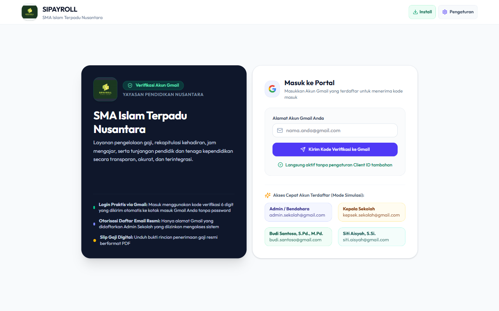

Ikuti langkah-langkah berikut untuk masuk menggunakan akun Gmail Anda:

1. Pastikan Anda berada di halaman **Masuk ke Portal**.
2. Pada kolom **Alamat Akun Gmail Anda** (berisi petunjuk *`nama.anda@gmail.com`*), ketikkan alamat Gmail Anda yang sudah terdaftar di sekolah.
3. Klik tombol **Kirim Kode Verifikasi ke Gmail** (saat diproses, tombol menampilkan *`Mengirim Kode Verifikasi...`*).
   - Jika format email belum valid, muncul peringatan: *"Masukkan alamat Gmail yang valid (contoh: nama@gmail.com)."*
   - Jika alamat Gmail belum didaftarkan oleh Admin Sekolah, muncul pesan penolakan akses (*"Akses Ditolak: Alamat Gmail '...' belum terdaftar..."*).
   - Jika berhasil pada **Mode Server Aktif**, muncul notifikasi *"Kode verifikasi 6 digit telah dikirim ke [alamat Gmail Anda]."* dan sistem mengirimkan email berjudul `[Kode] Kode Verifikasi Masuk — [Nama Sekolah]` ke Gmail Anda.
   - Jika berhasil pada **Mode Simulasi**, sistem memunculkan notifikasi *"Mode Simulasi — Kode OTP Gmail Anda: [6 digit]"* serta kotak kuning **Kode Simulasi** langsung di layar.
4. Buka kotak masuk Gmail Anda (periksa juga folder **Spam** jika belum terlihat di kotak masuk utama) untuk menyalin kode verifikasi 6 digit.
5. Kembali ke aplikasi SIPAYROLL. Pada kolom **Kode Verifikasi (6 Digit)** (berisi petunjuk *`000000`*), ketikkan 6 angka kode tersebut.
   - Pada **Mode Simulasi**, Anda cukup mengklik tombol **Isi Otomatis** di samping **Kode Simulasi** agar kolom kode terisi otomatis.

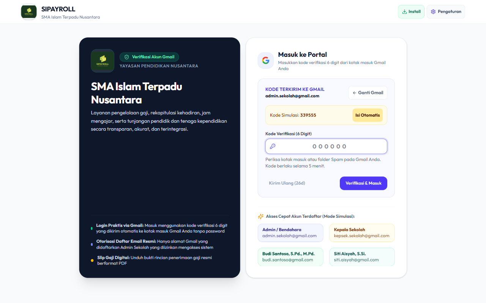

6. Klik tombol **Verifikasi & Masuk** (saat diproses, tombol menampilkan *`Memverifikasi...`*).
   - Jika angka yang dimasukkan kurang dari 6 digit, muncul peringatan: *"Masukkan tepat 6 digit kode verifikasi yang dikirim ke Gmail Anda."*
7. Jika kode cocok, muncul notifikasi *"Terverifikasi! Selamat datang, [Nama Anda]."* dan Anda langsung diarahkan ke dasbor sesuai peran akun Anda.

> **Perhatian:**
> * Setiap kode verifikasi hanya berlaku selama **5 menit** dan hanya dapat digunakan **1 kali**.
> * Jika kode salah dimasukkan hingga **5 kali percobaan**, kode otomatis hangus dan Anda harus meminta kode baru.
> * Tombol **Kirim Ulang Kode** memiliki jeda tunggu **30 detik** (ditampilkan sebagai *`Kirim Ulang (30d)`*) sebelum dapat diklik kembali.
> * Jika Anda salah mengetik alamat email, klik tombol **Ganti Gmail** untuk kembali ke langkah awal.

### Masuk Menggunakan Akun Gmail yang Pernah Digunakan di Perangkat

Setelah berhasil masuk minimal satu kali, SIPAYROLL menyimpan hingga **6 alamat Gmail** terakhir yang pernah digunakan pada perangkat tersebut di bagian **Akun Gmail yang pernah digunakan di perangkat ini**.

1. Pada halaman **Masuk ke Portal**, klik chip alamat Gmail Anda di bagian **Akun Gmail yang pernah digunakan di perangkat ini**.
2. Sistem akan langsung mengirimkan kode verifikasi 6 digit baru ke alamat Gmail tersebut dan membuka layar pengisian kode.
3. Untuk menghapus akun dari daftar perangkat (misalnya setelah menggunakan komputer bersama), klik ikon tempat sampah kecil di sebelah kanan alamat Gmail pada chip akun tersebut.

### Masuk Cepat pada Mode Simulasi (Demo)

Apabila aplikasi belum terhubung ke server sekolah (**Mode Simulasi** aktif), di bagian bawah kartu login tampil bagian **Akses Cepat Akun Terdaftar (Mode Simulasi)** berisi empat tombol akun contoh:
* **Admin / Bendahara** (`admin.sekolah@gmail.com`)
* **Kepala Sekolah** (`kepsek.sekolah@gmail.com`)
* **Budi Santoso, S.Pd., M.Pd.** (`budi.santoso@gmail.com`)
* **Siti Aisyah, S.Si.** (`siti.aisyah@gmail.com`)

Anda cukup mengklik salah satu kartu akun tersebut untuk langsung masuk ke dasbor peran terkait tanpa perlu memasukkan kode verifikasi.

## 1.5. Cara Keluar dari Aplikasi (**Keluar**)

Sesi login Anda berlaku selama **8 jam** selama tab browser tidak ditutup. Demi menjaga kerahasiaan data gaji, biasakan keluar secara manual setelah selesai menggunakan aplikasi.

1. Arahkan pandangan ke **Bilah Atas** (*Header*) di pojok kanan atas layar.
2. Klik tombol **Keluar** (tombol berwarna merah muda dengan ikon keluar).
3. Muncul notifikasi *"Anda telah keluar dari sesi aplikasi."* dan layar kembali ke halaman **Masuk ke Portal**.

> **Tips:** Jika Anda menutup tab atau jendela browser, sesi login otomatis berakhir sehingga Anda perlu melakukan verifikasi kode Gmail ulang saat membuka kembali aplikasi.

*Setelah berhasil masuk ke portal sesuai peran akun Anda, langkah selanjutnya adalah mengenali tata letak layar, pengaturan koneksi server Google Sheets, pemasangan aplikasi (PWA), dan navigasi utama pada Bab 2.*

---

# Bab 2: Mengenal Antarmuka Aplikasi

Antarmuka SIPAYROLL dirancang responsif agar nyaman digunakan di layar komputer (Desktop) maupun ponsel (Mobile). Aplikasi ini **tidak menggunakan sidebar samping**, melainkan memadukan **Bilah Atas** dan **Menu Tab** yang otomatis menyesuaikan ukuran layar perangkat Anda.

## 2.1. Mengenal Bilah Atas (*Navbar*)

**Bilah Atas** selalu menempel di bagian paling atas layar pada setiap halaman aplikasi.

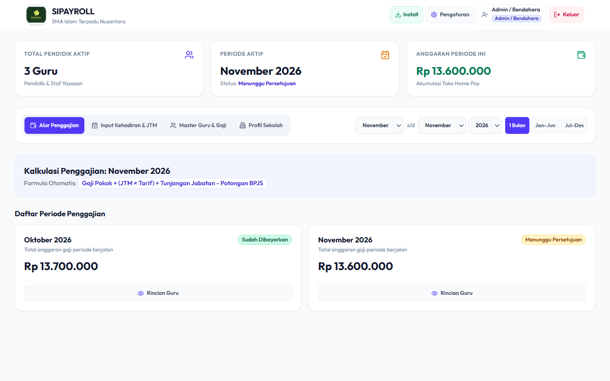

Komponen yang terdapat pada Bilah Atas dari kiri ke kanan adalah:
1. **Identitas Sekolah/Yayasan**: Menampilkan logo sekolah, nama singkat portal (bawaan: **SIPAYROLL**), serta nama sekolah atau yayasan yang aktif.
2. **Tombol Install**: Berwarna hijau muda untuk memasang aplikasi SIPAYROLL ke layar utama perangkat (tombol ini otomatis tersembunyi apabila aplikasi sudah dibuka dalam mode terinstal).
3. **Tombol Pengaturan**: Berikon roda gigi untuk membuka jendela **Pengaturan Koneksi Server** (dan tombol reset data saat berada di Mode Simulasi).
4. **Kartu Info Pengguna** *(tampil pada layar tablet/komputer setelah masuk)*: Menampilkan nama pengguna beserta lencana peran dengan warna pembeda:
   - **Admin / Bendahara** (lencana biru-ungu)
   - **Kepala Sekolah** (lencana kuning-oranye)
   - **Pendidik / Guru** (lencana hijau)
5. **Tombol Keluar**: Untuk mengakhiri sesi masuk Anda.

## 2.2. Mengatur Koneksi Server Google Sheets & Mode Simulasi

Siapa pun dapat membuka menu **Pengaturan** di Bilah Atas untuk menghubungkan aplikasi ke server Google Apps Script (Google Sheets) milik sekolah atau beralih ke **Mode Simulasi**.

1. Klik tombol **Pengaturan** di Bilah Atas.
2. Jendela **Pengaturan Koneksi Server** akan muncul di layar.

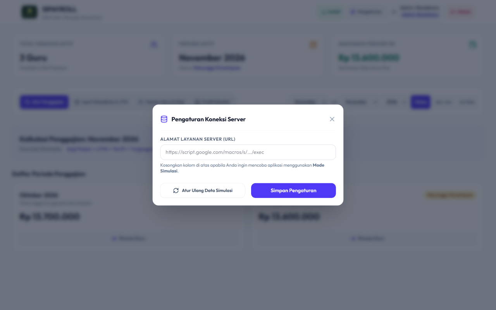

3. Pada kolom **Alamat Layanan Server (URL)** (berisi petunjuk *`https://script.google.com/macros/s/.../exec`*):
   - **Untuk terhubung ke Mode Server Aktif (Google Sheets sekolah)**: Tempelkan URL Web App yang diberikan pengelola IT/Admin sekolah, lalu klik **Simpan Pengaturan**. Muncul notifikasi *"Berhasil terhubung ke server utama!"* (jika alamat tidak diawali `https://script.google.com/`, muncul pesan kesalahan *"Alamat server tidak valid."*).
   - **Untuk beralih ke Mode Simulasi**: Kosongkan kolom **Alamat Layanan Server (URL)**, lalu klik **Simpan Pengaturan**. Muncul notifikasi *"Beralih ke Mode Simulasi."*
4. *(Khusus saat Mode Simulasi aktif)* Klik tombol **Atur Ulang Data Simulasi** apabila Anda ingin mengembalikan seluruh data latihan ke kondisi awal. Muncul notifikasi *"Data simulasi berhasil diatur ulang ke kondisi awal."*

> **Tips:** Aplikasi tidak menyediakan tombol atau tautan langsung untuk membuka file Google Sheets di browser. Seluruh sinkronisasi data ke Google Sheets berjalan otomatis di latar belakang melalui alamat server tersebut.

## 2.3. Memasang SIPAYROLL ke Layar Utama Perangkat (PWA)

SIPAYROLL dapat dipasang sebagai aplikasi di layar utama ponsel maupun komputer agar tampil penuh layaknya aplikasi bawaan (*Progressive Web App*).

1. Klik tombol **Install** pada Bilah Atas.
2. Pada perangkat Android atau browser komputer yang mendukung pemasangan langsung, dialog konfirmasi pemasangan dari browser akan muncul; ikuti petunjuk hingga tampil notifikasi *"SIPAYROLL berhasil di-install ke perangkat Anda!"*.
3. Jika browser tidak memicu dialog otomatis (misalnya Safari di iPhone/iPad), jendela panduan **Install Aplikasi SIPAYROLL (PWA)** akan terbuka dengan petunjuk berikut:
   - **Android (Chrome / Edge)**: Klik menu **⋮ (Titik Tiga)** di pojok kanan atas browser, lalu pilih **"Install app"** atau **"Tambahkan ke layar utama"**.
   - **iPhone / iPad (Safari)**: Klik tombol **Bagikan (Share)** di bilah bawah Safari, lalu pilih **"Add to Home Screen" (Tambah ke Layar Utama)**.
   - **Desktop (Chrome / Edge)**: Klik ikon **Install SIPAYROLL** di sisi kanan *address bar* browser.
4. Klik tombol **Mengerti** untuk menutup jendela panduan.

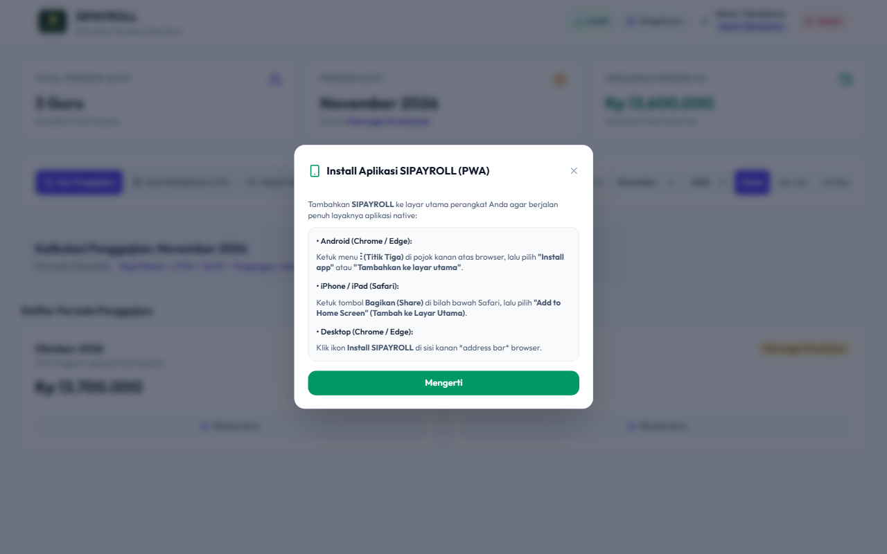

## 2.4. Navigasi & Tata Letak Dasbor per Peran Pengguna

Setelah masuk, halaman utama menampilkan **Kartu Ringkasan** di bagian atas dan **Area Kerja** di bawahnya. Cara berpindah antar-menu menyesuaikan ukuran layar:
* **Pada Layar Komputer / Tablet**: Menu tab berada di bagian atas area kerja dengan indikator tombol aktif berwarna biru-ungu.
* **Pada Layar Ponsel (*Mobile*)**: Menu tab berpindah menjadi **Bilah Tab Mengambang** berwarna gelap di bagian bawah layar agar mudah dijangkau ibu jari.

### A. Antarmuka Admin / Bendahara

1. **Kartu Ringkasan Atas (3 Kartu)**:
   - **Total Pendidik Aktif**: Menampilkan jumlah guru dan staf yayasan yang terdaftar.
   - **Periode Aktif**: Menampilkan bulan/rentang periode dan tahun yang dipilih beserta **Status**-nya (*Belum Dibuat*, *Draf*, *Menunggu Persetujuan*, *Disetujui Kepsek*, atau *Sudah Dibayarkan*).
   - **Anggaran Periode Ini**: Menampilkan akumulasi *Take Home Pay* pada periode aktif.
2. **Pemilih Periode Fleksibel**: Terletak di sisi kanan menu tab (atau di bawah kartu ringkasan pada ponsel), terdiri dari pilihan bulan awal `s/d` bulan akhir, pilihan tahun (`2025`–`2028`), serta tombol pintasan **1 Bulan**, **Jan–Jun**, dan **Jul–Des**.
3. **Empat Tab Menu Utama**:
   - **Alur Penggajian** *(di ponsel: **Penggajian**)*: Menghitung draf gaji, melihat rincian per guru, mengunduh PDF, mengajukan ke Kepala Sekolah, dan menandai sudah dibayar.
   - **Input Kehadiran & JTM** *(di ponsel: **Kehadiran & JTM**)*: Mencatat Hari Hadir, Hari Alpa, dan Total JTM (dilengkapi tombol **Kalkulator** JTM).
   - **Master Guru & Gaji** *(di ponsel: **Master Guru**, dilengkapi lencana jumlah guru)*: Mengelola profil pendidik, akun Gmail login, komponen gaji, serta impor masal Excel (`.XLSX`).
   - **Profil Sekolah**: Mengatur logo, nama yayasan/sekolah, alamat, kontak, dan pejabat penandatangan pada Slip Gaji PDF.

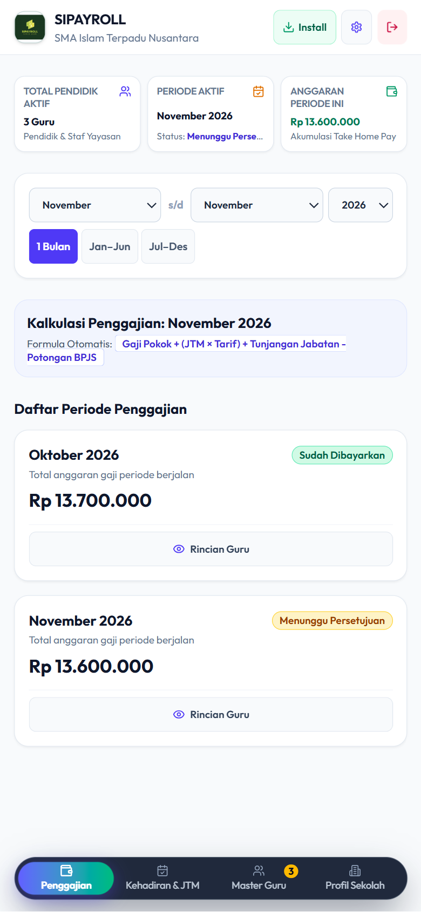

### B. Antarmuka Kepala Sekolah

1. **Kartu Ringkasan Atas (3 Kartu)**:
   - **Menunggu Persetujuan Anda**: Jumlah periode penggajian yang sudah diajukan bendahara dan menanti otorisasi Kepala Sekolah.
   - **Total Pendidik & Staf**: Jumlah total pendidik dan tenaga kependidikan yang tercatat.
   - **Total Periode Tercatat**: Jumlah seluruh riwayat periode penggajian di yayasan.
2. **Bagian Otorisasi Pengajuan Gaji (Kepala Sekolah)** dengan **Tiga Tab Filter**:
   - **Semua Periode**: Menampilkan seluruh periode dari status Draf hingga Sudah Dicairkan.
   - **Perlu Otorisasi** *(dilengkapi lencana jumlah antrean)*: Menyaring hanya periode berstatus *Menunggu Persetujuan Kepsek* untuk segera diperiksa.
   - **Telah Disetujui**: Menyaring periode yang sudah disetujui maupun yang sudah dicairkan.

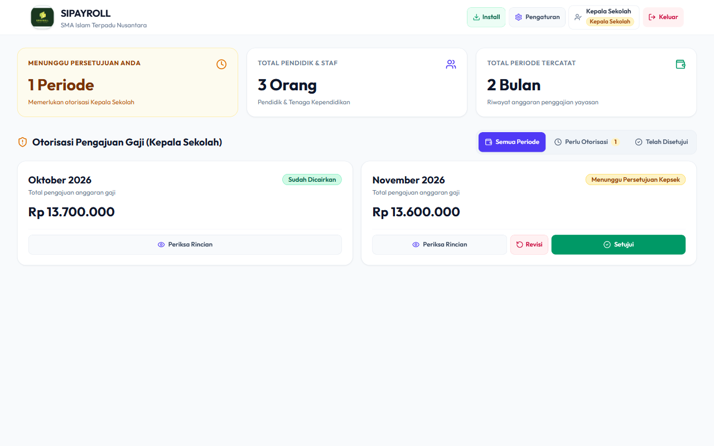

### C. Antarmuka Pendidik / Guru

1. **Pada Layar Komputer / Tablet**: Seluruh informasi tampil sekaligus dalam satu halaman tanpa perlu berpindah tab:
   - **Spanduk Profil** di bagian atas (*Portal Resmi Pendidik & Tenaga Kependidikan*) yang memuat Nama, NIP, Status Kepegawaian, Nomor Rekening, Email Gmail, dan kotak **Gaji Bersih Terakhir**.
   - **Riwayat Slip Gaji Digital** di bagian bawah yang menampilkan kartu slip gaji bulanan dan tombol **Unduh Slip Gaji Resmi (PDF)**.
2. **Pada Layar Ponsel (*Mobile*)**: Layar diringkas menjadi dua tab di bilah navigasi bawah:
   - **Slip Gaji Digital** *(dilengkapi lencana jumlah slip tersedia)*: Menampilkan daftar kartu riwayat slip gaji Anda.
   - **Profil Saya**: Menampilkan spanduk profil kepegawaian, nomor rekening tujuan transfer, dan gaji bersih terakhir.

## 2.5. Mengenal Notifikasi Aplikasi

Setiap tindakan yang Anda lakukan (seperti masuk, menyimpan data, mengunduh PDF, atau saat terjadi kesalahan) akan memunculkan kotak notifikasi singkat di bagian atas tengah layar selama sekitar **2 detik** dengan warna penanda:
* **Hijau**: Tindakan berhasil dijalankan.
* **Biru**: Informasi umum atau pengingat sistem.
* **Kuning/Oranye**: Peringatan agar Anda melengkapi atau memeriksa ulang isian.
* **Merah**: Terjadi kesalahan atau akses ditolak.

*Setelah memahami tata letak antarmuka dan navigasi untuk setiap peran, mari lanjutkan ke panduan operasional terperinci bagi **Admin / Bendahara Sekolah** pada Bab 3.*

---

# Bab 3: Panduan Fitur Utama — Admin / Bendahara Sekolah

Bab ini merupakan panduan operasional lengkap bagi pengguna dengan peran **Admin / Bendahara** di aplikasi **SIPAYROLL**. Pada **Mode Server Aktif**, setiap data yang Anda simpan di ketiga modul utama di bawah ini akan otomatis tersinkronisasi ke Google Sheets sekolah:

1. **Master Guru & Gaji** — Mengelola data profil pendidik, akun Gmail akses portal, dan rincian komponen gaji (tersimpan ke tab `Teachers`, `Salary_Components`, dan `Users_Auth`).
2. **Input Kehadiran & JTM** — Mencatat hari hadir, hari alpa, dan total Jam Tatap Muka (JTM) sesuai periode yang dipilih (tersimpan ke tab `Attendances`).
3. **Alur Penggajian** — Menghitung draf penggajian otomatis, memeriksa rincian slip guru, mengajukan persetujuan ke Kepala Sekolah, hingga mengonfirmasi pembayaran gaji (tersimpan ke tab `Payrolls` dan `Payroll_Details`).

> **Tips Urutan Kerja:** Untuk hasil perhitungan yang akurat, selalu kerjakan secara berurutan: **(1) Lengkapi Master Guru & Gaji → (2) Simpan Kehadiran & JTM pada periode yang sesuai → (3) Jalankan Alur Penggajian**.

## 3.1. Mengelola Master Data Guru & Komponen Gaji (**Master Guru & Gaji**)

**Tujuan Fitur:**
Modul **Master Guru & Gaji** berfungsi sebagai basis data induk seluruh pendidik dan tenaga kependidikan. Data yang disimpan di sini—mulai dari nomor rekening, akun Gmail untuk masuk ke portal, gaji pokok, tarif per JTM, tunjangan, hingga potongan—akan otomatis dipakai setiap kali Anda menghitung penggajian bulanan.

Untuk membuka modul ini, klik tab **Master Guru & Gaji** (pada ponsel: klik tab **Master Guru** di bilah bawah).

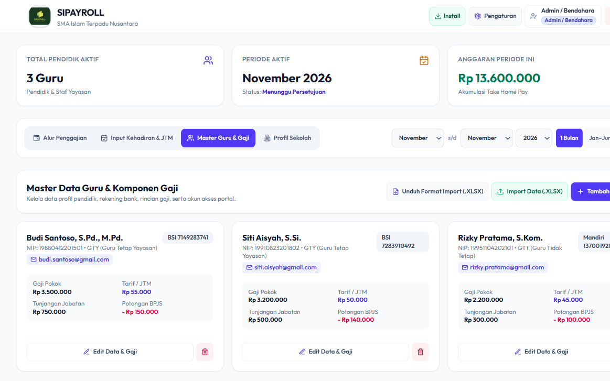

### 3.1.1. Menambah Data Guru Baru Secara Satuan

Gunakan cara ini apabila Anda ingin menambahkan satu atau beberapa guru baru secara langsung di aplikasi.

1. Pada halaman **Master Data Guru & Komponen Gaji**, klik tombol **Tambah Guru Baru** di sisi kanan atas.
2. Jendela formulir **Tambah Guru & Komponen Gaji** akan terbuka.
3. Lengkapi data identitas dan kepegawaian pada bagian atas formulir:
   * **NIP / NIY** *(wajib diisi)*: Nomor induk pegawai atau yayasan (contoh: `19900101202001`).
   * **Nama Lengkap & Gelar** *(wajib diisi)*: Nama lengkap beserta gelar akademik (contoh: `Ahmad Fauzi, S.Pd.`).
   * **Status Kepegawaian**: Pilih salah satu dari daftar:
     - `GTY (Guru Tetap Yayasan)`
     - `GTT (Guru Tidak Tetap)`
     - `PNS DPK`
     - `Staf Tata Usaha`
   * **Bank & Nomor Rekening** *(wajib diisi)*: Nama bank dan nomor rekening tujuan transfer gaji (contoh: `BSI 7192837465`).
4. Pada kotak **Akun Akses Portal Guru (Gmail)**, isi kolom **Alamat Gmail Guru** (contoh: `ahmad.fauzi@gmail.com`).
   * Saat disimpan, sistem otomatis mendaftarkan alamat Gmail ini ke daftar akun sekolah sehingga guru dapat langsung masuk menggunakan OTP Gmail tanpa kata sandi.
5. Pada bagian **Rincian Komponen Gaji**, masukkan nominal angka (pemisah ribuan titik otomatis terbentuk saat Anda mengetik):
   * **Gaji Pokok (Rp)** *(nilai bawaan: `3.000.000`)*
   * **Tarif Mengajar per JTM (Rp)** *(nilai bawaan: `50.000`)*
   * **Tunjangan Jabatan (Rp)** *(nilai bawaan: `500.000`)*
   * **Potongan BPJS (Rp)** *(nilai bawaan: `120.000`)*
6. *(Opsional)* Jika guru memiliki tunjangan atau potongan tambahan selain BPJS, tambahkan pada bagian **Potongan & Komponen Lainnya (Custom Admin)** (lihat Sub-bab 3.1.2).
7. Klik tombol **Simpan Data**. Jika berhasil, muncul notifikasi *"Guru baru & Komponen Gaji berhasil ditambahkan."*

> **Perhatian:**
> * Kolom **NIP / NIY**, **Nama Lengkap & Gelar**, dan **Bank & Nomor Rekening** wajib diisi. Jika salah satu kosong, sistem memunculkan peringatan: *"NIP, Nama Lengkap, dan Nomor Rekening wajib diisi."*
> * Jika **Alamat Gmail Guru** diisi dengan format yang salah (tidak mengandung tanda `@`), muncul peringatan: *"Masukkan alamat Gmail yang valid (contoh: nama.guru@gmail.com)."*
> * Setiap guru harus memiliki alamat Gmail yang unik. Jika Gmail sudah dipakai akun lain, penyimpanan ditolak dengan pesan *"Alamat Gmail sudah digunakan oleh akun lain."*

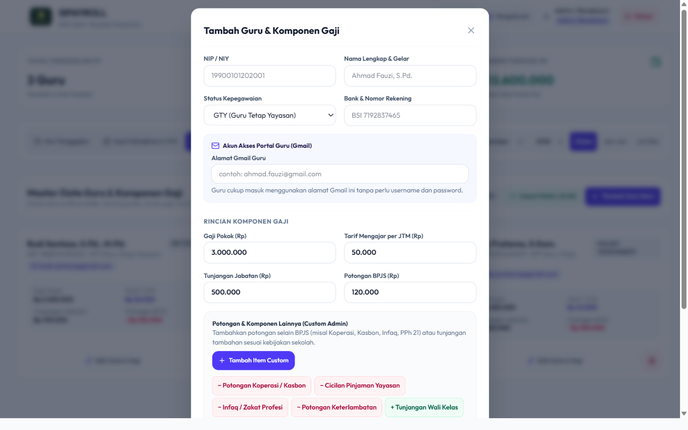

### 3.1.2. Menambah Potongan & Tunjangan Custom

**Tujuan Fitur:**
Selain 4 komponen standar (*Gaji Pokok*, *Tarif Mengajar per JTM*, *Tunjangan Jabatan*, dan *Potongan BPJS*), sekolah sering memiliki kebijakan tunjangan khusus (misalnya wali kelas atau uang makan) maupun potongan tambahan (misalnya koperasi, kasbon, atau infaq). Fitur ini memungkinkan Anda menyesuaikannya per guru.

Di dalam formulir **Tambah / Edit Guru & Komponen Gaji**, gulir ke kotak **Potongan & Komponen Lainnya (Custom Admin)**:

1. **Menggunakan Pilihan Cepat (*Preset*)**:
   Klik salah satu tombol preset yang tersedia untuk langsung menambahkan baris item:
   * Potongan (`−`): **Potongan Koperasi / Kasbon** (`Rp 100.000`), **Cicilan Pinjaman Yayasan** (`Rp 200.000`), **Infaq / Zakat Profesi** (`Rp 50.000`), **Potongan Keterlambatan** (`Rp 25.000`).
   * Tunjangan (`+`): **Tunjangan Wali Kelas** (`Rp 150.000`), **Tunjangan Transport & Makan** (`Rp 200.000`).
2. **Menambah Item Secara Manual**:
   Klik tombol **Tambah Item Custom** untuk memunculkan baris kosong baru.
3. Pada setiap baris item custom, atur 3 bagian berikut:
   * **Jenis Komponen**: Pilih **Potongan (−)** atau **Tunjangan (+)**.
   * **Nama potongan/tunjangan (misal: Koperasi)**: Ketik keterangan komponen (contoh: `Koperasi` atau `Tunjangan Lab`).
   * **Nominal (Rp)**: Masukkan jumlah rupiahnya.
4. Untuk menghapus baris yang tidak diperlukan, klik ikon tempat sampah di ujung kanan baris tersebut.
5. Periksa ringkasan otomatis di bagian bawah kotak (**Total Potongan (BPJS + Custom)** dan **Tunjangan Custom**) sebelum mengklik **Simpan Data**.

> **Tips:** Baris item custom yang kolom namanya dibiarkan kosong tidak akan ikut tersimpan saat Anda mengklik **Simpan Data**.

### 3.1.3. Mengubah dan Menghapus Data Guru

1. Pada daftar kartu guru di tab **Master Guru & Gaji**, cari guru yang ingin diperbarui.
2. **Untuk mengubah data**: Klik tombol **Edit Data & Gaji**, ubah data profil, alamat Gmail, atau komponen gaji pada jendela **Edit Data Guru & Komponen Gaji**, lalu klik **Simpan Data**. Notifikasi *"Data Guru & Komponen Gaji diperbarui."* akan tampil.
3. **Untuk menghapus data**: Klik tombol ikon tempat sampah merah di sebelah kanan tombol **Edit Data & Gaji**.
4. Akan muncul dialog konfirmasi **Hapus Data Guru** bertuliskan *"Apakah Anda yakin ingin menghapus data "[Nama Guru]" beserta komponen gajinya?"*. Klik **Ya, Lanjutkan** untuk menghapus, atau **Batal** jika ingin membatalkan.

> **Perhatian:** Menghapus data guru akan menghapus profil serta komponen gaji guru tersebut dari sistem.

### 3.1.4. Impor Data Guru & Komponen Gaji Secara Masal ke Google Sheets (`.XLSX`)

**Tujuan Fitur:**
Mempercepat pengisian atau pembaruan data puluhan hingga ratusan guru sekaligus dari berkas Microsoft Excel (`.xlsx`) langsung ke database Google Sheets sekolah tanpa harus mengetik satu per satu.

**Langkah 1: Unduh dan Isi Template Excel**
1. Klik tombol **Unduh Format Import (.XLSX)** pada bilah atas tab **Master Guru & Gaji** (atau klik tombol **Unduh Template Excel (.XLSX)** di dalam jendela import).
2. File bernama `Template_Import_Guru_SIPAYROLL.xlsx` akan otomatis terunduh ke perangkat Anda.
3. Buka file tersebut di Microsoft Excel atau Google Sheets. Pastikan isi kolom pada lembar kerja (*Sheet*) pertama sesuai urutan dan aturan berikut:
   * `nip` *(wajib)*: NIP/NIY guru.
   * `name` *(wajib)*: Nama lengkap beserta gelar.
   * `status`: Status kepegawaian (jika dikosongkan, otomatis diisi `GTY (Guru Tetap Yayasan)`).
   * `bank_account` *(wajib)*: Nama bank dan nomor rekening.
   * `base_salary`: Gaji pokok (angka).
   * `hourly_rate`: Tarif mengajar per JTM (angka).
   * `position_allowance`: Tunjangan jabatan (angka).
   * `bpjs_deduction`: Potongan BPJS (angka).
   * `email`: Alamat Gmail guru untuk akses masuk portal.
4. Simpan file dalam format `.xlsx`.

> **Tips Pembaruan Masal:** Jika Anda mengunggah file yang berisi **NIP yang sudah terdaftar** sebelumnya di Google Sheets, sistem tidak akan membuat data ganda, melainkan otomatis **memperbarui** data guru, komponen gaji standar, dan alamat Gmail untuk NIP tersebut.

**Langkah 2: Unggah, Pratinjau, dan Jalankan Impor**
1. Di tab **Master Guru & Gaji**, klik tombol **Import Data (.XLSX)** untuk membuka jendela **Import Master Data Guru & Komponen Gaji (.XLSX)**.
2. Pada **Langkah 2**, klik **Pilih File Excel (.XLSX) dari Perangkat**, lalu pilih file Excel yang sudah Anda siapkan.
   * Jika file bukan berformat `.xlsx` atau `.xls`, muncul peringatan *"Harap pilih file Excel berformat .XLSX (Template Import SIPAYROLL)."*
   * Jika lembar kerja kosong, muncul peringatan *"File Excel (.xlsx) kosong atau tidak memiliki baris data."*
3. Sistem langsung menampilkan **Pratinjau Data Import** beserta jumlah baris **Valid** dan **Tidak Valid**:
   * Baris berlabel **Guru Baru** (hijau): Akan ditambahkan sebagai guru baru.
   * Baris berlabel **Update Data (NIP Sama)** (kuning): Akan memperbarui data guru yang sudah ada.
   * Baris berwarna merah muda menandakan **Tidak Valid**, disertai alasan kesalahannya (*"NIP, Nama, dan Rekening wajib diisi"* atau *"Format alamat Gmail tidak valid"*). Baris tidak valid akan dilewati saat proses impor.
4. Jika ingin mengganti file atau membatalkan pratinjau, klik **Bersihkan Pratinjau** atau **Ganti File Excel (.XLSX)**.
5. Jika pratinjau sudah sesuai, klik tombol **Import [Jumlah] Data Guru** di pojok kanan bawah.
6. Tunggu hingga muncul notifikasi sukses jumlah data baru dan data yang diperbarui.

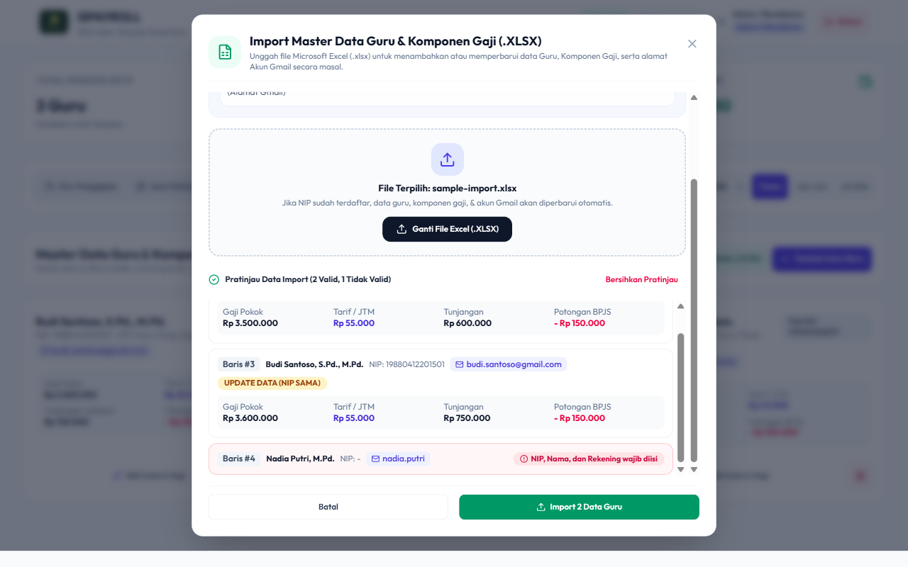

> **Catatan:** Template Excel hanya mencakup 4 komponen gaji standar. Jika guru tertentu memerlukan komponen *custom* (seperti Koperasi atau Tunjangan Wali Kelas), tambahkan melalui tombol **Edit Data & Gaji** setelah proses impor selesai.

## 3.2. Mengatur Periode & Mencatat Kehadiran serta JTM (**Input Kehadiran & JTM**)

**Tujuan Fitur:**
Modul **Input Kehadiran & JTM** digunakan untuk mencatat jumlah hari hadir, hari alpa, serta total Jam Tatap Muka (JTM) setiap guru pada bulan atau rentang periode tertentu. Angka **Total JTM** inilah yang nantinya dikalikan dengan **Tarif Mengajar per JTM** saat kalkulasi penggajian.

### 3.2.1. Memilih Periode Penggajian Fleksibel

Di bagian atas area kerja (di bawah 3 Kartu Ringkasan), terdapat panel **Pemilih Periode Fleksibel** yang memengaruhi data pada tab **Input Kehadiran & JTM** maupun **Alur Penggajian**:

1. Pilih **Bulan Awal (Dari)** pada dropdown pertama dan **Bulan Akhir (Hingga)** pada dropdown kedua (dipisahkan tanda `s/d`).
2. Pilih **Tahun** pada dropdown ketiga (`2025` s/d `2028`).
3. Untuk mempercepat pemilihan, Anda dapat langsung mengklik tombol pintasan di bawahnya:
   * **1 Bulan**: Menyamakan bulan akhir dengan bulan awal (penggajian 1 bulan normal, misalnya *November 2026*).
   * **Jan–Jun**: Mengatur rentang periode semester pertama (*Januari – Juni*, tampil lencana **6 Bulan**).
   * **Jul–Des**: Mengatur rentang periode semester kedua (*Juli – Desember*, tampil lencana **6 Bulan**).

> **Perhatian:** Saat menggunakan **Mode Server Aktif** (terhubung ke Google Sheets) dan memilih rentang multi-bulan (misalnya **Jan–Jun**), pastikan Anda mengisi dan menyimpan data kehadiran pada rentang periode tersebut di tab **Input Kehadiran & JTM** terlebih dahulu sebelum membuat draf penggajian. Jika catatan kehadiran untuk periode yang dipilih belum tersimpan, nilai JTM pada draf otomatis dihitung `0`.

### 3.2.2. Mengisi Kehadiran & JTM per Guru atau Kolektif

1. Buka tab **Input Kehadiran & JTM** (pada ponsel: klik tab **Kehadiran & JTM**).
2. Pastikan periode pada judul halaman (*Input Kehadiran & Jam Tatap Muka (JTM) — [Bulan/Rentang] [Tahun]*) sudah sesuai.
3. Pada setiap kartu guru, nilai awal tampilan untuk periode yang belum pernah disimpan adalah Hadir `20`, Alpa `0`, dan JTM `24`. Ubah sesuai data aktual pada tiga kolom berikut:
   * **Hari Hadir**: Jumlah hari kehadiran (batas maksimal `31 × jumlah bulan pada periode`).
   * **Hari Alpa**: Jumlah hari ketidakhadiran tanpa keterangan.
   * **Total JTM (Jam)**: Total jam mengajar pada periode tersebut (batas maksimal `200 × jumlah bulan pada periode`).
4. Perhatikan baris **Estimasi Honor Mengajar (JTM × Tarif)** di bagian bawah kartu; nilainya akan otomatis berubah mengikuti angka **Total JTM** yang Anda ketik.
5. Untuk menyimpan data ke sistem/Google Sheets:
   * **Simpan satu guru saja**: Klik tombol **Simpan** di pojok kanan atas kartu guru tersebut. Muncul notifikasi *"Kehadiran [Nama Guru] disimpan."*
   * **Simpan seluruh guru sekaligus**: Klik tombol **Simpan Semua Kehadiran** di bagian atas halaman. Muncul notifikasi *"Seluruh data kehadiran [Periode] [Tahun] tersimpan!"*

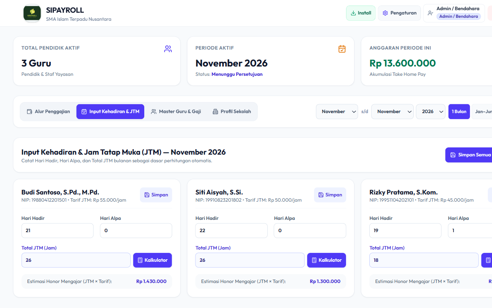

> **Tips:** Nilai bawaan `20` hari hadir dan `24` JTM pada layar hanya merupakan angka bantu awal di formulir, belum tersimpan ke database sebelum Anda mengklik **Simpan** atau **Simpan Semua Kehadiran**.

### 3.2.3. Menggunakan Kalkulator Total JTM Interaktif

**Tujuan Fitur:**
Membantu bendahara menjumlahkan jam mengajar guru secara cepat tanpa membuka aplikasi kalkulator terpisah—baik berdasarkan rincian kelas/pertemuan maupun berdasarkan jadwal mingguan.

1. Pada kartu guru di tab **Input Kehadiran & JTM**, klik tombol biru **Kalkulator** di sebelah kanan kolom **Total JTM (Jam)**.
2. Jendela **Kalkulator Total JTM** akan terbuka menampilkan nama guru dan tarif per JTM-nya.
3. Pilih salah satu dari dua mode perhitungan:

   **Pilihan A — Mode `Kalkulator Angka` (untuk penjumlahan/perkalian bebas):**
   * Klik tombol angka (`0`–`9`) dan operator (`+`, `−`, `×`), atau ketik langsung di kotak **Ekspresi (Ketik atau gunakan tombol)** (contoh: `6 + 6 + 4 + 8` atau `6 * 4`).
   * Anda juga bisa mengklik tombol pintasan cepat: **+2 Jam**, **+4 Jam**, **+6 Jam**, **× 4 Minggu**, atau **× 5 Minggu**.
   * Klik **=** untuk menyederhanakan ekspresi menjadi hasil angka, tombol panah hapus untuk menghapus 1 karakter, atau **C** untuk membersihkan layar.

   **Pilihan B — Mode `Rumus Mingguan` (untuk jadwal rutin per minggu):**
   * Isi **JTM per Minggu (Jam)** *(contoh: `6`)*.
   * Pilih **Minggu Efektif Bulan Ini** (`1 Minggu` s/d `5 Minggu`, bawaan `4 Minggu`).
   * Isi **+ Jam Tambahan / Pengganti** jika guru mengisi kelas pengganti atau jam ekstra.
   * Isi **− Potongan Jam Kosong / Alpa** jika ada jam mengajar yang tidak terlaksana.

4. Pantau layar gelap di bagian atas kalkulator untuk melihat **Estimasi Honor JTM** dan **Hasil Total JTM** secara langsung.
5. Klik tombol **Gunakan [Jumlah] Jam** untuk memasukkan hasil hitungan ke kolom **Total JTM (Jam)** guru tersebut.

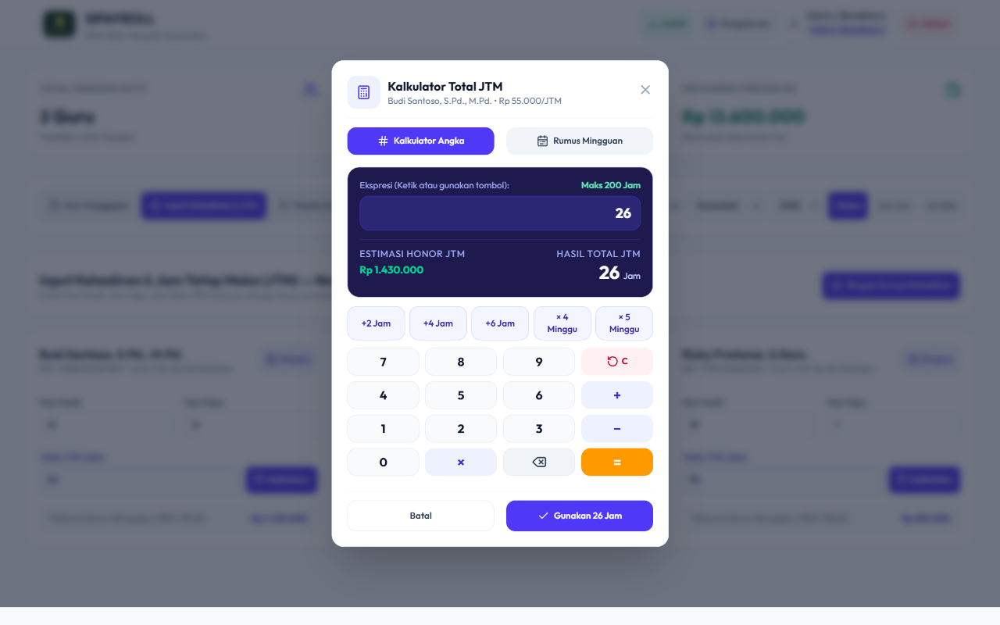

> **Perhatian:**
> * Kalkulator JTM membatasi hasil maksimal hingga **200 Jam** per bulan.
> * Setelah mengklik **Gunakan [Jumlah] Jam**, jangan lupa mengklik tombol **Simpan** pada kartu guru (atau **Simpan Semua Kehadiran**) agar data benar-benar tersimpan sebelum Anda membuat draf gaji.

## 3.3. Menjalankan Alur Penggajian (**Alur Penggajian**)

**Tujuan Fitur:**
Modul **Alur Penggajian** adalah pusat proses penggajian setiap periode. Di sinilah seluruh komponen gaji guru dan catatan JTM digabungkan menjadi draf rincian gaji, diajukan untuk diperiksa Kepala Sekolah, hingga ditandai selesai dibayarkan agar Slip Gaji Digital resmi terbit untuk masing-masing guru.

Untuk membukanya, klik tab **Alur Penggajian** (pada ponsel: klik tab **Penggajian**).

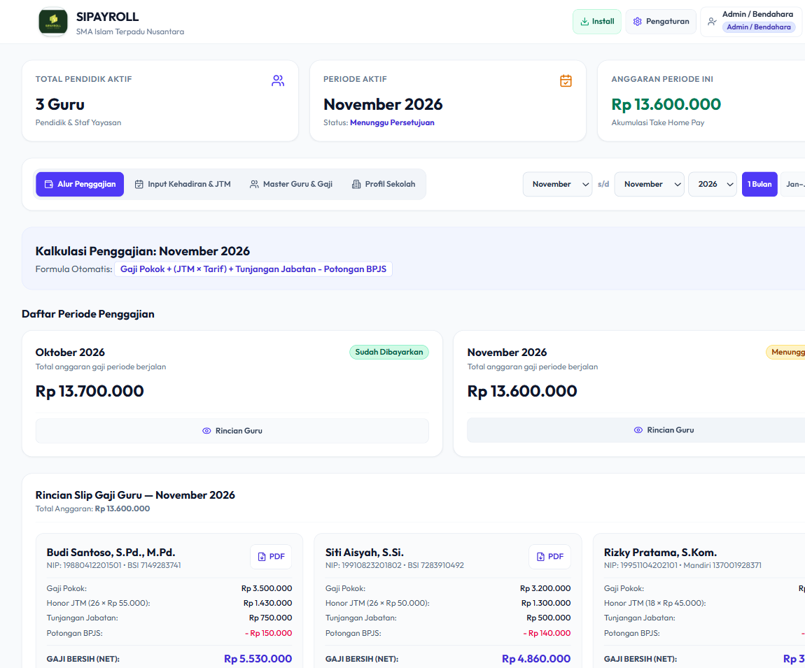

### 3.3.1. Memahami Rumus Perhitungan & Status Periode

Setiap kali draf dibuat, sistem menghitung gaji bersih (*Take Home Pay*) tiap guru dengan rumus:
* **Penerimaan Kotor (*Gross*)** = `Gaji Pokok + (Total JTM × Tarif/JTM) + Tunjangan Jabatan + Total Tunjangan Custom`
* **Gaji Bersih (*Net / Take Home Pay*)** = `Penerimaan Kotor − Potongan BPJS − Total Potongan Custom` *(minimal Rp 0)*

Setiap periode memiliki empat tahapan status yang ditandai dengan lencana warna:
1. **Draf** *(abu-abu)*: Baru dibuat atau dikembalikan Kepala Sekolah untuk revisi. Data gaji masih bisa dihitung ulang.
2. **Menunggu Persetujuan** *(kuning)*: Sudah diajukan ke Kepala Sekolah dan **terkunci** (tidak bisa dihitung ulang oleh Admin selama menunggu keputusan Kepala Sekolah).
3. **Disetujui Kepsek** *(biru-ungu)*: Sudah disetujui Kepala Sekolah dan siap dicairkan oleh bendahara.
4. **Sudah Dibayarkan** *(hijau)*: Pencairan dana telah dikonfirmasi selesai oleh bendahara.

### 3.3.2. Membuat & Menghitung Ulang Draf Penggajian

1. Pastikan bulan/rentang dan tahun pada **Pemilih Periode Fleksibel** sudah sesuai dengan periode yang akan digaji.
2. Perhatikan kotak biru **Kalkulasi Penggajian: [Periode] [Tahun]** di bagian atas tab **Alur Penggajian**.
3. Klik tombol **Generate Draf Penggajian**.
   * Jika periode tersebut sudah memiliki draf berstatus **Draf**, tombol berubah nama menjadi **Kalkulasi Ulang Draf**. Gunakan tombol ini apabila Anda baru saja mengubah gaji guru atau memperbarui catatan kehadiran/JTM.
4. Sistem akan otomatis menghitung total anggaran, menyimpannya ke Google Sheets, menampilkan notifikasi *"Draf Payroll [Periode] [Tahun] berhasil dikalkulasi!"*, serta membuka panel **Rincian Slip Gaji Guru** di bagian bawah halaman.

> **Perhatian:** Anda hanya bisa menjalankan **Generate Draf Penggajian** / **Kalkulasi Ulang Draf** selama status periode masih **Belum Dibuat** atau **Draf**. Jika statusnya sudah **Menunggu Persetujuan**, **Disetujui Kepsek**, atau **Sudah Dibayarkan**, periode tersebut terkunci agar nominal yang sudah diperiksa tidak berubah secara sepihak.

### 3.3.3. Memeriksa Rincian Slip & Mengunduh PDF per Guru

1. Pada daftar **Daftar Periode Penggajian**, klik tombol **Rincian Guru** pada kartu periode yang ingin diperiksa.
2. Bagian **Rincian Slip Gaji Guru — [Periode] [Tahun]** akan terbuka di bawah daftar periode, menampilkan:
   * **Total Anggaran** untuk seluruh guru pada periode tersebut.
   * Kartu rincian untuk masing-masing guru yang memuat: Nama, NIP, Nomor Rekening, rincian *Gaji Pokok*, *Honor JTM*, *Tunjangan Jabatan*, seluruh item *Custom* (`+` tunjangan / `−` potongan), *Potongan BPJS*, dan **Gaji Bersih (Net)**.
3. Untuk mengunduh dokumen resmi slip gaji guru tertentu, klik tombol **PDF** di pojok kanan atas kartu guru tersebut. File PDF bernama `Slip_Gaji_[NIP]_[Bulan]_[Tahun].pdf` akan langsung terunduh.
4. Klik tombol **X** di pojok kanan atas panel rincian untuk menutup tampilan rincian.

### 3.3.4. Mengajukan Draf ke Kepala Sekolah

Setelah seluruh rincian guru pada draf dipastikan benar:

1. Pada periode yang berstatus **Draf**, klik tombol kuning **Ajukan ke Kepsek** (bisa dari banner atas maupun langsung dari kartu periode di **Daftar Periode Penggajian**).
2. Dialog konfirmasi **Ajukan Penggajian ke Kepala Sekolah** akan muncul menampilkan periode dan total anggaran yang diajukan.
3. Klik **Ya, Lanjutkan**.
4. Status periode berubah menjadi **Menunggu Persetujuan**, dan pengajuan langsung muncul di dasbor Kepala Sekolah.

> **Tips Jika Ada Kesalahan Setelah Diajukan:** Jika ternyata ada angka yang keliru setelah pengajuan dikirim, minta Kepala Sekolah mengklik tombol **Revisi** pada dasbor beliau agar status periode kembali menjadi **Draf**, lalu lakukan perbaikan dan klik **Kalkulasi Ulang Draf**.

### 3.3.5. Mengonfirmasi Pembayaran Gaji (**Sudah Dibayarkan**)

Setelah Kepala Sekolah menyetujui pengajuan (status berubah menjadi **Disetujui Kepsek**) dan bendahara selesai mentransfer gaji ke rekening masing-masing pendidik:

1. Buka tab **Alur Penggajian** dan temukan periode yang berstatus **Disetujui Kepsek**.
2. Klik tombol hijau **Tandai Sudah Dibayar** (pada banner atas) atau **Tandai Dibayar** (pada kartu periode).
3. Dialog konfirmasi **Konfirmasi Pencairan Gaji** akan muncul dengan keterangan bahwa slip gaji digital akan diterbitkan ke dasbor masing-masing guru.
4. Klik **Ya, Lanjutkan**.
5. Status periode berubah menjadi **Sudah Dibayarkan**, dan seluruh pendidik dapat melihat serta mengunduh slip gaji periode tersebut dari akun masing-masing.

## 3.4. Contoh Skenario Penggunaan Bulanan

Agar lebih mudah membayangkan alurnya, berikut contoh skenario kerja Bendahara Sekolah untuk penggajian bulan **November 2026**:

1. **Minggu Pertama (Pembaruan Data Guru Baru):**
   Bendahara menerima SK pengangkatan seorang guru honorer baru, *Nadia Putri, M.Pd.*, dan seorang guru lama mendapatkan tugas tambahan sebagai wali kelas.
   - Bendahara membuka tab **Master Guru & Gaji**, klik **Tambah Guru Baru**, mengisi NIP, nama, status *GTT*, rekening bank, alamat Gmail `nadia.putri@gmail.com`, dan komponen gajinya, lalu klik **Simpan Data**.
   - Untuk guru lama, Bendahara klik **Edit Data & Gaji**, klik preset **+ Tunjangan Wali Kelas** (`Rp 150.000`), lalu klik **Simpan Data**.
2. **Akhir Bulan (Rekap Kehadiran & JTM):**
   - Bendahara membuka tab **Input Kehadiran & JTM** dan memastikan pemilih periode berada di **November s/d November 2026** (klik pintasan **1 Bulan**).
   - Untuk *Budi Santoso, S.Pd., M.Pd.* yang jadwalnya 6 JTM/minggu selama 4 minggu efektif ditambah 2 jam kelas pengganti, Bendahara klik tombol **Kalkulator**, memilih mode **Rumus Mingguan**, mengisi `6` JTM/minggu, `4 Minggu`, dan `+ 2` jam tambahan, lalu klik **Gunakan 26 Jam**.
   - Setelah seluruh guru diisi, Bendahara klik **Simpan Semua Kehadiran** agar data tersimpan ke Google Sheets.
3. **Proses Penggajian & Pengajuan:**
   - Bendahara berpindah ke tab **Alur Penggajian**, lalu klik **Generate Draf Penggajian**.
   - Bendahara meninjau panel **Rincian Slip Gaji Guru** untuk memastikan *Take Home Pay* seluruh guru sudah sesuai.
   - Setelah yakin, Bendahara klik **Ajukan ke Kepsek** dan klik **Ya, Lanjutkan**. Status berubah menjadi **Menunggu Persetujuan**.
4. **Setelah Disetujui & Ditransfer:**
   - Keesokan harinya, Kepala Sekolah menyetujui pengajuan sehingga status berubah menjadi **Disetujui Kepsek**.
   - Bendahara mentransfer gaji ke rekening masing-masing guru sesuai rincian, lalu kembali ke **Alur Penggajian** dan klik **Tandai Sudah Dibayar** (atau **Tandai Dibayar** pada kartu periode). Kini seluruh guru bisa mengunduh Slip Gaji Digital bulan November 2026 dari perangkat masing-masing.

*Setelah memahami tugas lengkap Admin / Bendahara dari hulu ke hilir, mari melihat alur kerja dari sisi **Kepala Sekolah** saat mengaudit dan mengesahkan gaji, serta sisi **Pendidik / Guru** saat mengunduh slip gaji resmi pada Bab 4.*

---

# Bab 4: Panduan Fitur — Kepala Sekolah & Pendidik / Guru

Bab ini melengkapi alur operasional SIPAYROLL dari sudut pandang pimpinan (**Kepala Sekolah**) yang bertindak sebagai pengaudit sekaligus pemberi otorisasi pencairan gaji, serta dari sudut pandang penerima gaji (**Pendidik / Guru**).

## 4.1. Panduan Kepala Sekolah — Audit & Otorisasi Penggajian

**Tujuan Fitur:**
Dasbor Kepala Sekolah dirancang ringkas agar pimpinan dapat memeriksa pengajuan anggaran gaji yang dikirim oleh Admin / Bendahara, memastikan rincian gaji tiap guru wajar sebelum dicairkan, lalu menyetujui atau meminta revisi.

### 4.1.1. Memfilter Daftar Pengajuan (**Semua Periode**, **Perlu Otorisasi**, **Telah Disetujui**)

1. Masuk menggunakan akun **Kepala Sekolah**.
2. Pada bagian **Otorisasi Pengajuan Gaji (Kepala Sekolah)**, pilih salah satu dari tiga tab filter (di layar atas pada desktop, atau di **Bilah Tab Mengambang** bawah pada ponsel):
   * **Semua Periode**: Menampilkan seluruh periode dengan status **Draf Bendahara**, **Menunggu Persetujuan Kepsek**, **Disetujui Kepsek (Siap Cair)**, dan **Sudah Dicairkan**.
   * **Perlu Otorisasi** *(dilengkapi lencana angka)*: Menampilkan daftar periode yang berstatus **Menunggu Persetujuan Kepsek** dan menunggu keputusan Anda.
   * **Telah Disetujui**: Menampilkan periode berstatus **Disetujui Kepsek (Siap Cair)** dan **Sudah Dicairkan**.

### 4.1.2. Memeriksa Rincian Gaji Pendidik (**Periksa Rincian**)

1. Pada kartu periode yang ingin diperiksa, klik tombol **Periksa Rincian**.
2. Panel **Audit Rincian Gaji Pendidik — [Bulan] [Tahun]** akan terbuka di bagian bawah layar menampilkan **Total Anggaran** beserta kartu rincian per pendidik (*NIP, Hadir, JTM, Gaji Pokok, Honor JTM, Tunjangan, item Custom, Potongan BPJS,* dan **Take Home Pay**).
3. Setelah selesai memeriksa, klik tombol **X** di pojok kanan atas panel untuk menutupnya.

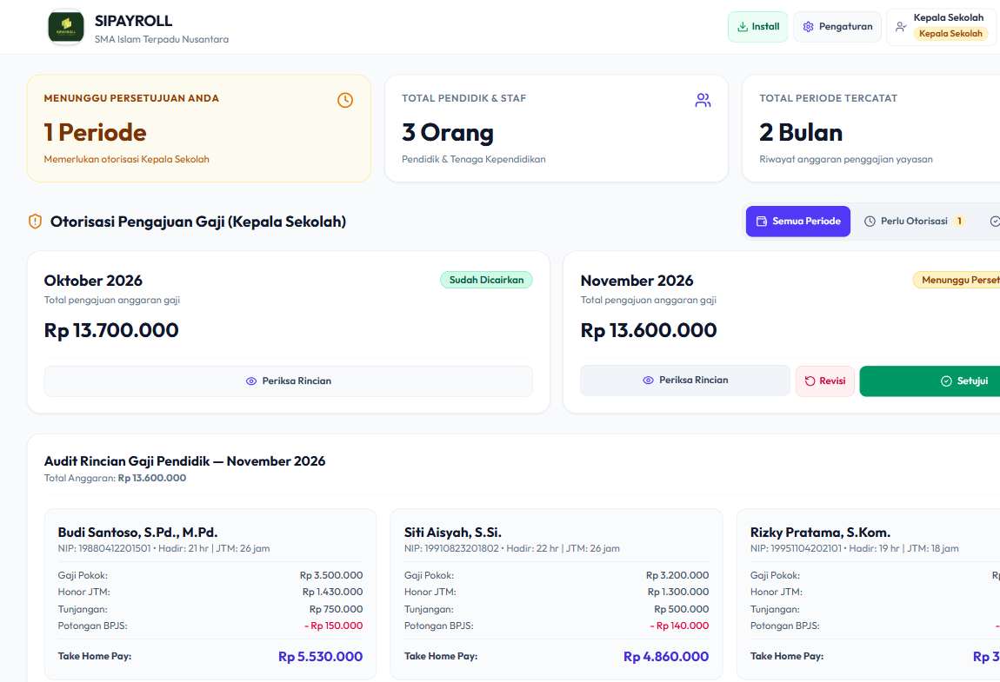

### 4.1.3. Menyetujui (**Setujui**) atau Mengembalikan Draf (**Revisi**)

Tombol **Revisi** dan **Setujui** hanya tampil pada kartu periode yang berstatus **Menunggu Persetujuan Kepsek**:

1. **Menyetujui Penggajian**:
   - Klik tombol hijau **Setujui** pada kartu periode.
   - Dialog konfirmasi **Setujui Penggajian Bulanan** akan muncul menampilkan nominal total anggaran periode tersebut.
   - Klik **Ya, Lanjutkan** (atau **Batal** untuk menunda). Muncul notifikasi *"Penggajian [Bulan] [Tahun] resmi DISETUJUI!"*, dan status berubah menjadi **Disetujui Kepsek (Siap Cair)** sehingga Bendahara dapat melanjutkan pencairan dana.
2. **Mengembalikan untuk Perbaikan**:
   - Jika ditemukan ketidaksesuaian angka, klik tombol merah muda **Revisi**.
   - Dialog konfirmasi **Kembalikan ke Draf (Revisi)** akan muncul.
   - Klik **Ya, Lanjutkan**. Muncul notifikasi *"Penggajian dikembalikan ke status Draft."*, dan status periode kembali menjadi draf agar Admin / Bendahara dapat memperbaikinya.

## 4.2. Panduan Pendidik / Guru — Profil & Slip Gaji Digital

**Tujuan Fitur:**
Memudahkan setiap pendidik dan tenaga kependidikan memeriksa profil kepegawaian, melihat transparansi komponen penghasilan dan potongan bulanan, serta mengunduh Slip Gaji Resmi berformat PDF secara mandiri.

### 4.2.1. Melihat Informasi Kepegawaian & Gaji Bersih Terakhir (**Profil Saya**)

1. Masuk menggunakan akun Gmail Anda yang terdaftar sebagai **Pendidik / Guru**.
2. Pada komputer/tablet, spanduk **Portal Resmi Pendidik & Tenaga Kependidikan** tampil langsung di bagian atas halaman. Pada ponsel, klik tab **Profil Saya** di bilah bawah.
3. Periksa data diri Anda (Nama, **NIP**, Status Kepegawaian, Bank & Nomor Rekening, Email Gmail, serta kotak **Gaji Bersih Terakhir**). Seluruh data profil ini bersifat **hanya baca** guna menjaga integritas data penggajian.

### 4.2.2. Membaca Rincian & Mengunduh Slip Gaji Resmi (**Unduh Slip Gaji Resmi (PDF)**)

1. Pada bagian **Riwayat Slip Gaji Digital** (pada ponsel: klik tab **Slip Gaji Digital**), daftar slip gaji Anda ditampilkan dalam bentuk kartu per periode.
   * Slip gaji hanya muncul apabila pengajuan periode tersebut sudah berstatus **Disetujui** oleh Kepala Sekolah atau **Dibayarkan** oleh Bendahara. Jika belum ada slip terbit, layar menampilkan pesan *"Belum ada slip gaji yang diterbitkan untuk akun Anda."*
2. Setiap kartu memuat rincian kehadiran (*Hadir, Alpa, JTM*), **Gaji Pokok**, **Honor Mengajar ([X] JTM × Rp ...)**, **Tunjangan Jabatan**, komponen tunjangan/potongan tambahan (jika ada), **Potongan BPJS**, dan **Gaji Bersih (Take Home Pay)**.
3. Klik tombol **Unduh Slip Gaji Resmi (PDF)** pada kartu periode yang diinginkan.
4. File PDF bernama `Slip_Gaji_[NIP]_[Bulan]_[Tahun].pdf` langsung terunduh ke perangkat Anda disertai notifikasi *"Slip Gaji [Bulan] [Tahun] berhasil diunduh (PDF)."*.

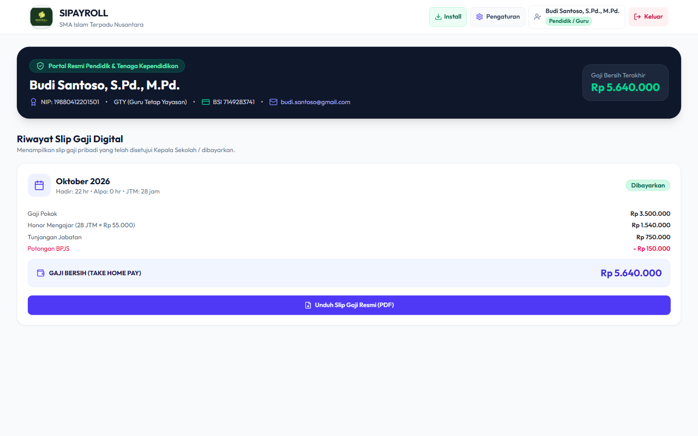

*Selanjutnya, pada Bab Penutup (Bab 5), Anda dapat mempelajari pengaturan identitas sekolah/yayasan, tata tertib pengelolaan file Google Sheets, tanya jawab (FAQ), dan tabel solusi kendala teknis.*

---

# Bab 5: Penutup — Pengaturan, Pengelolaan Google Sheets, FAQ, dan Troubleshooting

Bab penutup ini membahas cara mengelola pengaturan aplikasi dan identitas sekolah, aturan penting menjaga struktur database **Google Sheets** agar aplikasi tidak mengalami gangguan, daftar pertanyaan yang sering diajukan (**FAQ**), serta tabel **Troubleshooting** berdasarkan penanganan kesalahan di antarmuka web maupun server **Google Apps Script (GAS)**.

## 5.1. Pengaturan Aplikasi, Profil, dan Preferensi Koneksi

### 5.1.1. Mengatur Profil & Identitas Sekolah / Yayasan *(Khusus Admin / Bendahara)*

Admin / Bendahara dapat menyesuaikan logo, nama institusi, dan nama pejabat penandatangan yang tampil pada Bilah Atas aplikasi, halaman **Masuk ke Portal**, serta dokumen **Slip Gaji Resmi (PDF)**. Pada **Mode Server Aktif**, perubahan profil disimpan di server sekolah agar otomatis tampil sama di seluruh perangkat pengguna.

1. Masuk sebagai **Admin / Bendahara**, lalu klik tab **Profil Sekolah**.
2. **Mengubah Logo Sekolah / Yayasan**:
   - Klik **Unggah Gambar Logo** lalu pilih gambar berformat **PNG, JPG, WEBP, atau SVG** (otomatis dioptimalkan hingga ukuran maksimal 240×240 piksel agar tajam di PDF).
   - Klik **Gunakan Logo Bawaan** bila ingin kembali ke logo awal aplikasi.
3. **Mengubah Identitas Yayasan & Unit Sekolah**:
   - Isi **Nama Yayasan / Badan Penyelenggara** dan **Nama Sekolah / Madrasah / Unit** *(minimal salah satu wajib diisi)*.
   - Ubah **Nama Singkat Portal** (bawaan: `SIPAYROLL`), **Alamat Lengkap Sekolah / Yayasan**, **Kontak Telepon & Email**, dan **Kota Penerbitan Slip**.
4. **Mengubah Pejabat Penandatangan & Catatan Kaki PDF**:
   - Isi **Nama Kepala Sekolah**, **NIP / NIY Kepala Sekolah**, **Nama Bendahara Sekolah / Yayasan**, **NIP / NIY Bendahara**, serta **Catatan Kaki (Footer) Slip Gaji PDF**.
5. Tinjau hasilnya pada kotak **Pratinjau Kop & Pengesahan Slip Gaji PDF** (*Live Preview*) atau uji melalui tombol **Tes Unduh Slip PDF**.
6. Klik **Simpan Profil Sekolah / Yayasan** hingga muncul notifikasi *"Profil & Identitas Sekolah/Yayasan berhasil disimpan!"*. Klik **Reset Awal** di pojok kanan atas jika ingin kembali ke setelan awal.

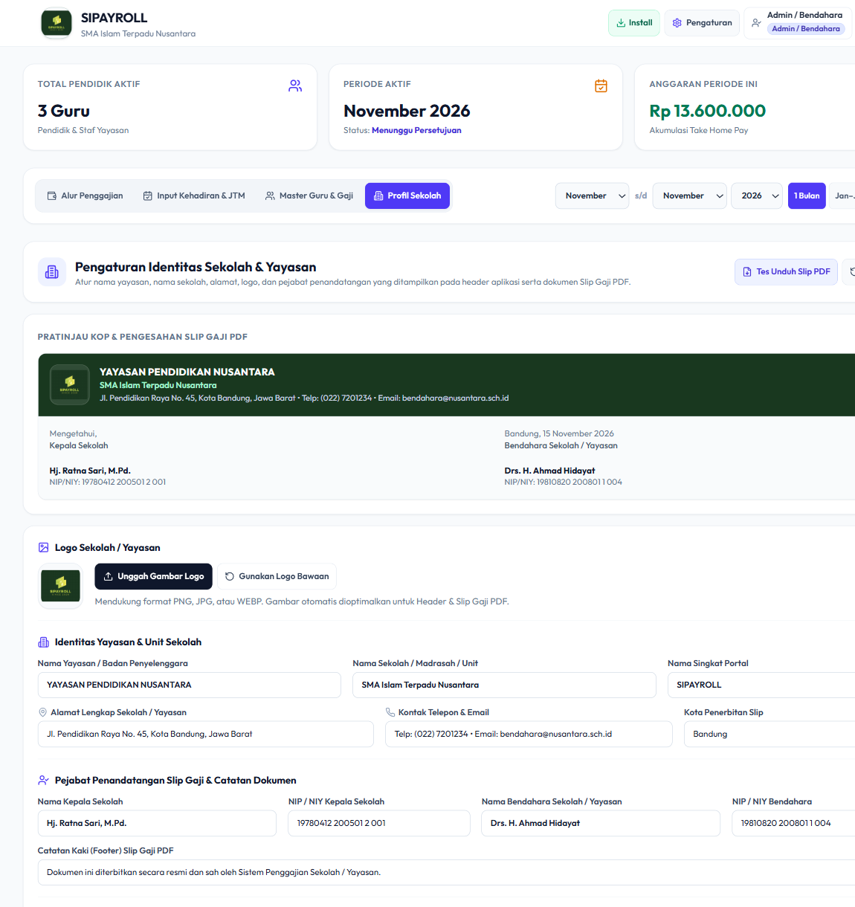

### 5.1.2. Profil Pribadi Pendidik / Guru & Kata Sandi

* **Profil Pribadi Guru (`Profil Saya`)**: Informasi kepegawaian pada dasbor **Pendidik / Guru** (Nama, NIP, Status Kepegawaian, Bank & Nomor Rekening, dan Alamat Gmail) bersifat **hanya baca** agar data penggajian tetap konsisten. Untuk mengubahnya, hubungi **Admin / Bendahara** agar diperbarui melalui **Master Guru & Gaji → Edit Data & Gaji**.
* **Pengaturan Kata Sandi**: SIPAYROLL **tidak memiliki menu ubah kata sandi**, karena seluruh pengguna masuk menggunakan **verifikasi kode OTP 6 digit ke Gmail** tanpa kata sandi.

### 5.1.3. Pengaturan Koneksi Server & Mode Simulasi

Semua pengguna dapat mengatur koneksi aplikasi melalui tombol **Pengaturan** (ikon roda gigi) di Bilah Atas *(lihat langkah terperinci pada Sub-bab 2.2)*:

1. Klik **Pengaturan** untuk membuka jendela **Pengaturan Koneksi Server**.
2. Pada kolom **Alamat Layanan Server (URL)**:
   - **Terhubung ke Mode Server Aktif (Google Sheets Sekolah)**: Tempelkan URL Web App GAS sekolah (harus diawali `https://script.google.com/`), lalu klik **Simpan Pengaturan**.
   - **Beralih ke Mode Simulasi**: Kosongkan kolom tersebut dan klik **Simpan Pengaturan**.
3. *(Khusus Mode Simulasi)* Klik **Atur Ulang Data Simulasi** untuk mengembalikan seluruh data latihan ke kondisi awal.

## 5.2. Catatan Penting Pengelolaan Google Sheet

Pada **Mode Server Aktif**, aplikasi menyimpan seluruh data sekolah ke dalam **6 tab Google Sheets**. Apabila Admin atau pengelola sekolah membuka file Google Sheets secara langsung untuk melihat atau mencadangkan data, patuhi aturan berikut agar aplikasi tidak mengalami error atau kehilangan data:

> **Perhatian Keras Pengelola Google Sheets:**
> 1. **Jangan Mengubah Nama Tab Sheet**: Aplikasi mencari 6 nama tab persis berikut: `Users_Auth`, `Teachers`, `Salary_Components`, `Attendances`, `Payrolls`, dan `Payroll_Details`. Jika salah satu tab diganti namanya (misalnya `Teachers` diubah menjadi `Daftar Guru`), server akan menganggap tab tersebut belum ada dan membuat tab `Teachers` baru yang kosong sehingga data terlihat hilang.
> 2. **Jangan Menghapus atau Mengubah Baris Header (Baris 1)**: Baris pertama setiap tab dibekukan sebagai nama kolom database. Menghapus baris header akan menyebabkan data baris kedua dianggap sebagai header dan seluruh data gagal terbaca dengan benar.
> 3. **Jangan Mengubah Urutan atau Menyisipkan Kolom di Tengah**: Server membaca dan menulis data berdasarkan posisi kolom secara berurutan (kolom A selalu berisi kode unik `id` untuk melacak baris saat edit/hapus). Menyisipkan kolom baru di tengah atau menggeser urutan kolom akan membuat data tersimpan ke kolom yang salah.
> 4. **Jangan Mengedit Kolom `id`, `user_id`, `teacher_id`, `payroll_id`, atau `details_json` Secara Manual**: Kolom-kolom ini saling terhubung menggunakan kode UUID unik dan format JSON. Mengubahnya secara manual dapat memutus relasi data slip gaji atau login guru.
> 5. **Aturan Penulisan di Tab `Users_Auth`**: Kolom `role` hanya boleh diisi `admin` (atau `bendahara`), `kepsek` (atau `kepala sekolah`), atau `guru` (atau `pendidik`). Pastikan tab `Users_Auth` tidak pernah kosong dan minimal memiliki satu akun `admin`.
> 6. **Hindari Karakter Rumus di Awal Teks**: Saat mengetik teks manual (seperti nama atau NIP), jangan mengawali isi sel dengan tanda `=`, `+`, `-`, atau `@` agar tidak terbaca sebagai rumus spreadsheet.

Berikut referensi susunan **nama tab dan urutan kolom wajib** di Google Sheets agar tetap terjaga:

| Nama Tab Sheet | Urutan Kolom Wajib (Baris 1, dimulai dari Kolom A) |
| :--- | :--- |
| `Users_Auth` | `id`, `username`, `password_hash`, `role` *(juga mendukung kolom `email`)* |
| `Teachers` | `id`, `user_id`, `nip`, `name`, `status`, `bank_account` |
| `Salary_Components` | `id`, `teacher_id`, `base_salary`, `hourly_rate`, `position_allowance`, `bpjs_deduction`, `custom_components_json` |
| `Attendances` | `id`, `teacher_id`, `month`, `year`, `present_days`, `absent_days`, `total_jtm` |
| `Payrolls` | `id`, `month`, `year`, `total_budget`, `status` |
| `Payroll_Details` | `id`, `payroll_id`, `teacher_id`, `net_salary`, `details_json` |

## 5.3. Pertanyaan yang Sering Diajukan (FAQ)

**1. Mengapa saat pertama kali dibuka atau setelah lama tidak dipakai, aplikasi terasa memuat agak lama (beberapa detik)?**
Itu adalah kondisi wajar (*cold start*) pada server gratis Google Apps Script ketika baru aktif kembali setelah tidak menerima permintaan beberapa saat. Permintaan kedua dan seterusnya biasanya akan jauh lebih cepat.

**2. Mengapa tidak ada menu Daftar (Registrasi) dan Lupa Kata Sandi?**
SIPAYROLL menggunakan login tanpa kata sandi (*passwordless*) berbasis akun Gmail yang terdaftar. Anda tidak perlu membuat atau mengingat kata sandi; cukup masukkan alamat Gmail yang sudah didaftarkan oleh **Admin / Bendahara** untuk menerima kode verifikasi 6 digit.

**3. Bagaimana jika guru mengganti alamat Gmail atau salah ketik nomor rekening?**
Guru tidak dapat mengubah data pribadinya dari dasbor guru. Minta **Admin / Bendahara** membuka tab **Master Guru & Gaji**, klik **Edit Data & Gaji** pada kartu guru bersangkutan, perbarui **Alamat Gmail Guru** atau **Bank & Nomor Rekening**, lalu klik **Simpan Data**.

**4. Mengapa halaman Slip Gaji Digital Guru kosong padahal gaji sudah dihitung bendahara?**
Slip gaji hanya muncul di akun **Pendidik / Guru** apabila periode penggajian sudah berstatus **Disetujui Kepsek** (`Disetujui`) atau **Sudah Dibayarkan** (`Dibayarkan`). Selama status masih **Draf** atau **Menunggu Persetujuan**, slip gaji belum diterbitkan ke akun guru.

**5. Admin sudah terlanjur mengklik "Ajukan ke Kepsek", ternyata ada nilai JTM atau potongan yang keliru. Bagaimana cara memperbaikinya?**
Selama berstatus **Menunggu Persetujuan**, draf terkunci. Minta **Kepala Sekolah** masuk ke dasbor beliau dan mengklik tombol **Revisi** pada periode tersebut agar statusnya kembali menjadi **Draf**. Setelah itu Admin dapat memperbaiki data lalu mengklik **Kalkulasi Ulang Draf**.

**6. Apa perbedaan Mode Simulasi dengan Mode Server Aktif?**
**Mode Simulasi** menyimpan data contoh secara lokal di browser Anda untuk keperluan latihan tanpa menyentuh Google Sheets sekolah. **Mode Server Aktif** terjadi ketika **Alamat Layanan Server (URL)** di menu **Pengaturan** terisi URL Web App sekolah, sehingga seluruh data langsung tersimpan ke Google Sheets.

**7. Apakah mengimpor ulang file Excel (`.XLSX`) akan membuat data guru menjadi ganda?**
Tidak, selama kolom `nip` sama persis dengan data guru yang sudah ada. Sistem otomatis mendeteksinya sebagai **Update Data (NIP Sama)** untuk memperbarui profil, komponen gaji standar, dan akun Gmail guru tersebut.

**8. Apakah tombol "Gunakan [Jumlah] Jam" di Kalkulator Total JTM otomatis menyimpan ke Google Sheets?**
Belum. Tombol tersebut hanya mengisi angka ke kotak **Total JTM (Jam)** di layar. Anda wajib mengklik tombol **Simpan** pada kartu guru atau **Simpan Semua Kehadiran** agar data tersimpan ke server.

**9. Mengapa saat menyimpan kehadiran banyak guru sekaligus atau mengimpor ratusan data terkadang butuh waktu agak lama?**
Setiap penyimpanan data melalui Google Apps Script menggunakan antrean penguncian data (*lock*) agar data Google Sheets tidak saling menimpa saat diakses bersamaan. Pastikan koneksi internet stabil dan tunggu notifikasi hijau muncul sebelum menutup halaman.

## 5.4. Pemecahan Masalah (Troubleshooting)

Tabel berikut merangkum kendala teknis, pesan validasi form, toast notifikasi, serta respons error dari server Google Apps Script (GAS) beserta solusi praktisnya:

| Kendala / Pesan Error | Penyebab Utama | Solusi |
| :--- | :--- | :--- |
| **Loading data terasa lambat beberapa detik di awal saat membuka aplikasi atau login** | Server Google Apps Script mengalami *cold start* (bangun dari kondisi jeda setelah lama tidak diakses) atau koneksi internet perangkat sedang lambat. | 1. Tunggu 3–8 detik hingga proses selesai tanpa mengklik tombol berulang kali. 2. Setelah respons pertama berhasil, akses menu berikutnya akan berjalan lebih cepat. 3. Jika lebih dari 20 detik tidak merespons, periksa jaringan internet lalu muat ulang halaman. |
| **Data gagal tersimpan karena koneksi terputus, batas waktu eksekusi habis, atau muncul pesan:** `Resource Locked: Server sedang memproses transaksi lain. Silakan coba beberapa saat lagi.` / `Gagal menghubungi server GAS: ...` | Koneksi internet terputus di tengah penyimpanan, dua Admin menyimpan data bersamaan (*lock* maksimal 15 detik), atau penyimpanan kolektif melebihi batas waktu eksekusi GAS. | 1. Tunggu 5–15 detik lalu coba klik tombol **Simpan** kembali. 2. Jika menyimpan kehadiran untuk sangat banyak guru (ratusan baris) dan gagal di tengah jalan, gunakan tombol **Simpan** per guru atau bagi bertahap. 3. Untuk input guru masal, gunakan fitur **Import Data (.XLSX)** yang mengirim data dalam satu paket sehingga jauh lebih cepat dan aman. |
| **Data guru/kehadiran/payroll tiba-tiba terlihat kosong, salah kolom, atau muncul error setelah spreadsheet diedit manual** | Admin mengubah nama tab sheet (misal `Teachers`), menghapus baris header (baris 1), mengubah urutan kolom, atau menyisipkan kolom baru di tengah tabel Google Sheets. | 1. Buka Google Sheets sekolah dan periksa 6 nama tab wajib (`Users_Auth`, `Teachers`, `Salary_Components`, `Attendances`, `Payrolls`, `Payroll_Details`). 2. Kembalikan perubahan menggunakan **Version History (Riwayat Versi)** di Google Sheets (*File → Version history → See version history*). 3. Jika terlanjur terbuat tab duplikat kosong akibat salah nama tab, pindahkan data ke tab asli yang benar sesuai urutan kolom pada Sub-bab 5.2. |
| **`Spreadsheet tidak ditemukan. Pastikan skrip dibuat melalui Extensions > Apps Script di dalam Google Sheets...`** | Skrip GAS dibuat terpisah (*standalone*) dan belum dihubungkan ke ID file Google Sheets sekolah. | 1. Laporkan ke **Pengelola IT Sekolah** agar memastikan skrip GAS dibuat dari dalam file Google Sheets melalui menu **Extensions → Apps Script** (atau mengisi ID Spreadsheet di konfigurasi skrip). |
| **`Akses Ditolak: Alamat Gmail "..." belum terdaftar pada sheet Users_Auth.`** *(atau `...belum terdaftar pada daftar akun (Users_Auth) oleh Admin Sekolah.`)* | Alamat Gmail yang dimasukkan belum didaftarkan oleh Admin di sistem, salah ketik email, atau aplikasi sedang berada di Mode Simulasi/server yang berbeda. | 1. Periksa ejaan alamat Gmail Anda. 2. Pastikan **Alamat Layanan Server (URL)** di menu **Pengaturan** sudah terhubung ke server sekolah. 3. Hubungi **Admin / Bendahara** agar Gmail Anda didaftarkan pada **Master Guru & Gaji** (untuk Guru) atau di tab `Users_Auth` Google Sheets (untuk Admin/Kepsek). |
| **Kendala otorisasi Akun Google / OAuth:** `Akses Ditolak: Akun Google "..." telah terverifikasi, namun belum terdaftar di sheet Users_Auth.` / `Google OAuth Client ID tidak cocok.` / `Harap verifikasi kepemilikan Akun Google Anda menggunakan kode OTP yang dikirim ke Gmail.` | Akun Google sudah terverifikasi tetapi email belum dicatat di tab `Users_Auth`, konfigurasi Google Client ID berbeda dengan server, atau sesi verifikasi Google tidak terbaca. | 1. Gunakan metode login utama **Kirim Kode Verifikasi ke Gmail** (OTP 6 digit) yang langsung aktif tanpa memerlukan Client ID tambahan. 2. Pastikan alamat email Google Anda sudah tercantum di tab `Users_Auth` Google Sheets sekolah. 3. Jika memakai OAuth Client ID khusus, minta Pengelola IT menyamakan konfigurasi Client ID di server GAS. |
| **`Sheet Users_Auth masih kosong. Daftarkan alamat Gmail Admin terlebih dahulu.`** / **`Kolom role di Users_Auth harus bernilai: admin, kepsek, atau guru.`** | Tab `Users_Auth` di Google Sheets belum memiliki satupun baris pengguna, atau isi kolom `role` salah ketik (misal `staff` atau `superuser`). | 1. Buka tab `Users_Auth` di Google Sheets sekolah. 2. Tambahkan baris akun Admin dengan mengisi `username` (alamat Gmail) dan `role` bernilai `admin`, `kepsek`, atau `guru`. |
| **Kendala OTP Gmail tidak masuk / gagal kirim:** `Gagal mengirim kode verifikasi ke Gmail (...Izin MailApp belum aktif)` | Email OTP masuk ke folder Spam/Promosi, izin kirim email di GAS belum disetujui pemilik skrip, atau kuota kirim email harian akun Google penyedia GAS sudah penuh. | 1. Periksa folder **Spam** atau **Updates** di Gmail Anda. 2. Tunggu 30 detik lalu klik **Kirim Ulang Kode**. 3. Jika muncul pesan `Izin MailApp belum aktif`, minta Pengelola IT menjalankan inisialisasi ulang di Editor Apps Script dan menyetujui izin akses Gmail (*Allow*), lalu *Deploy New Version*. |
| **`Kode verifikasi tidak ditemukan atau sudah kedaluwarsa.`** / **`Kode verifikasi 6 digit tidak sesuai.`** / **`Terlalu banyak percobaan salah. Silakan minta kode verifikasi baru.`** | Masa berlaku kode OTP (**5 menit**) habis, salah ketik hingga **5 kali**, atau memasukkan kode dari email OTP lama setelah meminta kode baru. | 1. Klik **Kirim Ulang Kode** (atau **Ganti Gmail** untuk mengulang). 2. Masukkan tepat 6 angka dari email verifikasi paling baru dalam batas waktu 5 menit. |
| **`Akses ditolak oleh Google Apps Script (HTTP 403 Forbidden)`** / **`Respons tidak terduga dari GAS`** / **`Alamat server tidak valid.`** | URL Web App salah (tidak diawali `https://script.google.com/` atau berakhiran `/dev` bukan `/exec`), atau izin deployment Web App belum disetel ke *Anyone*. | 1. Klik **Pengaturan** di Bilah Atas dan pastikan URL berakhiran `/exec`. 2. Minta Pengelola IT memastikan pada pengaturan *Deploy → Manage deployments* di GAS opsi **Who has access** disetel ke **Anyone** dan menggunakan versi terbaru. |
| **`Unauthorized: Sesi berakhir atau token tidak valid.`** / **`Token sesi telah kedaluwarsa.`** | Masa sesi login (**8 jam**) berakhir atau terjadi pembaruan server saat sesi berlangsung. | 1. Klik **Keluar** atau muat ulang (*refresh*) halaman browser. 2. Masuk kembali dengan verifikasi OTP Gmail. |
| **`NIP, Nama Lengkap, dan Nomor Rekening wajib diisi.`** / **`Alamat Gmail sudah digunakan oleh akun lain.`** | Salah satu kolom wajib di formulir guru masih kosong, atau Gmail yang diketik sudah dipakai akun lain. | 1. Isi lengkap **NIP / NIY**, **Nama Lengkap & Gelar**, dan **Bank & Nomor Rekening**. 2. Gunakan alamat Gmail pribadi yang belum dipakai akun lain, lalu klik **Simpan Data**. |
| **`Harap pilih file Excel berformat .XLSX`** / **`File Excel (.xlsx) kosong`** / **`Gagal membaca struktur file Excel (.xlsx).`** / **`Tidak ada baris data valid untuk di-import.`** | Format file bukan `.xlsx`/`.xls`, file rusak, sheet pertama kosong, atau pada baris Excel ada kolom wajib (`nip`, `name`, `bank_account`) yang kosong / format email salah. | 1. Unduh file resmi lewat **Unduh Format Import (.XLSX)** (`Template_Import_Guru_SIPAYROLL.xlsx`). 2. Isi data mulai baris 2 di sheet pertama tanpa mengubah baris header. 3. Periksa baris berwarna merah muda pada **Pratinjau Data Import**, perbaiki di Excel, lalu unggah ulang. |
| **`Payroll periode ini sudah diajukan/disetujui dan terkunci.`** *(atau `...tidak dapat di-generate ulang.`)* | Periode sudah berstatus **Menunggu Persetujuan**, **Disetujui Kepsek**, atau **Sudah Dibayarkan** sehingga terkunci dari kalkulasi ulang. | 1. Jika masih **Menunggu Persetujuan**, minta **Kepala Sekolah** mengklik **Revisi** agar status kembali menjadi **Draf**. 2. Setelah kembali ke **Draf**, klik **Kalkulasi Ulang Draf** di tab **Alur Penggajian**. |
| **`403 Forbidden: Anda tidak memiliki otorisasi...`** / **`403 Forbidden: Role akun tidak dikenali.`** / **`Belum ada slip gaji yang diterbitkan untuk akun Anda.`** | Akun mencoba membuka aksi peran lain, nilai `role` tidak dikenali, atau untuk Guru: gaji bulan berjalan belum disetujui/dibayarkan atau Gmail login belum tertaut ke data guru. | 1. Pastikan Anda login dengan akun peran yang sesuai. 2. Untuk Guru, pastikan Admin sudah mengajukan dan Kepala Sekolah sudah menyetujui penggajian periode tersebut, serta Gmail login Anda sama dengan yang tercatat pada kartu guru di **Master Guru & Gaji**. |
| **`Nama Yayasan atau Nama Sekolah wajib diisi.`** / **`Pilih file gambar yang valid (PNG, JPG, WEBP, atau SVG).`** | Kolom Nama Yayasan dan Nama Sekolah sama-sama kosong di tab **Profil Sekolah**, atau file logo bukan format gambar yang didukung. | 1. Isi minimal salah satu dari **Nama Yayasan** atau **Nama Sekolah**. 2. Unggah logo berformat `.png`, `.jpg`, `.webp`, atau `.svg` yang tidak rusak, lalu klik **Simpan Profil Sekolah / Yayasan**. |
